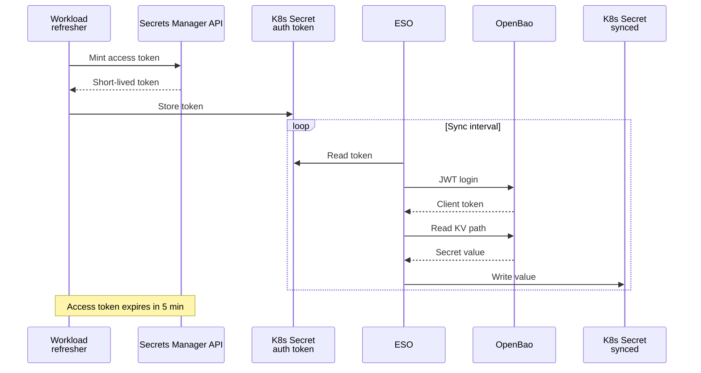



- Édition : GitLab Premium, GitLab Ultimate
- Offre : GitLab.com, GitLab Self-Managed
- Statut : version bêta





- [Introduction](https://gitlab.com/gitlab-org/gitlab/-/issues/594090) dans GitLab 19.2 [avec le feature flag](../../../administration/feature_flags/_index.md) `secrets_manager_api_access`. Fonctionnalité désactivée par défaut.



Les jobs CI/CD lisent les secrets de [GitLab Secrets Manager](_index.md) via GitLab Runner. Les autres charges de travail lisent les secrets via l'[API Secrets Manager](../../../api/secrets_manager.md). Les exemples incluent les applications Kubernetes et les outils Infrastructure as Code.

Les lectures vont directement vers le backend OpenBao, de sorte que la disponibilité des secrets ne dépend pas de l'application GitLab.

## Flow du jeton d'accès {#access-token-flow}

1. Un client s'authentifie auprès de GitLab avec un jeton d'accès personnel, un jeton de compte de service, ou un jeton d'accès de projet ou de groupe ayant la portée `api`.
1. Le client appelle l'API Secrets Manager pour créer un jeton d'accès de courte durée. La réponse inclut le jeton et les détails de connexion à OpenBao.
1. Le client présente le jeton au backend OpenBao pour lire la valeur du secret.

Le jeton d'accès expire après cinq minutes. OpenBao implémentant l'API Vault, vous pouvez présenter le jeton avec n'importe quel client compatible [HashiCorp Vault](https://developer.hashicorp.com/vault).

Chaque détail de connexion OpenBao provient de la réponse de création, vous n'avez donc pas à construire vous-même les chemins d'espace de nommage, de montage ou d'authentification.

## Prérequis {#prerequisites}

- GitLab Secrets Manager est activé.
- Le Secrets Manager a été provisionné dans GitLab 19.2 ou une version ultérieure.
- Vous vous authentifiez avec un jeton d'accès personnel, un jeton d'accès de projet ou de groupe, ou un jeton de [compte de service](#authenticate-with-a-service-account) ayant la portée `api`.
- Votre rôle est au minimum Reporter.
- Vous disposez de la permission de lecture de valeur. Un propriétaire de projet (ou un propriétaire de groupe, pour les secrets de groupe) peut accorder cette permission. Voir [Gérer les permissions des secrets](_index.md#manage-secrets-permissions).

> [!note]
> Les Secrets Managers provisionnés avant GitLab 19.2 ne prennent pas en charge l'accès depuis des requêtes ou services externes. Pour activer l'accès externe, voir [Activer l'accès aux secrets depuis des requêtes externes](../../../administration/secrets_manager/maintenance.md#enable-secrets-access-from-external-requests).

## S'authentifier avec un compte de service {#authenticate-with-a-service-account}

Prérequis :

- Permission de créer des [comptes de service](../../../user/profile/service_accounts.md#types-of-service-accounts).
- Le rôle Propriétaire pour le projet ou le groupe, afin d'accorder les permissions sur les secrets.

Pour s'authentifier avec un compte de service :

1. [Créer un compte de service](../../../user/profile/service_accounts.md#create-a-service-account).
1. [Créer un jeton d'accès personnel](../../../user/profile/service_accounts.md#create-a-personal-access-token-for-a-service-account) pour le compte de service avec la portée `api`.
1. [Ajouter le compte de service](../../../user/profile/service_accounts.md#add-a-service-account-to-a-group-or-project) au projet ou au groupe avec au minimum le rôle Reporter.
1. [Accorder au compte de service la permission de lecture de valeur](_index.md#manage-secrets-permissions).

## Lire un secret {#read-a-secret}

Cet exemple crée un jeton d'accès pour un projet, s'authentifie auprès d'OpenBao, puis lit une valeur de secret.

1. Créer un jeton d'accès. Le jeton avec lequel vous vous authentifiez doit avoir la portée `api` :

   ```shell
   RESPONSE=$(curl --silent --request POST \
     --header "PRIVATE-TOKEN: <your_access_token>" \
     --url "https://gitlab.example.com/api/v4/projects/<project_id>/secrets_manager/access_token")
   ```

   La réponse contient un objet `provider.vault` avec les détails `server`, `namespace`, `path`, `secrets_path` et `auth.jwt`, ainsi qu'un `token` de courte durée.

1. S'authentifier auprès d'OpenBao avec le jeton retourné, puis lire la valeur :

   ```shell
   SERVER=$(echo "$RESPONSE" | jq --raw-output .provider.vault.server)
   NAMESPACE=$(echo "$RESPONSE" | jq --raw-output .provider.vault.namespace)
   MOUNT=$(echo "$RESPONSE" | jq --raw-output .provider.vault.path)
   SECRETS_PATH=$(echo "$RESPONSE" | jq --raw-output .provider.vault.secrets_path)
   AUTH_PATH=$(echo "$RESPONSE" | jq --raw-output .provider.vault.auth.jwt.path)
   ROLE=$(echo "$RESPONSE" | jq --raw-output .provider.vault.auth.jwt.role)
   JWT=$(echo "$RESPONSE" | jq --raw-output .provider.vault.auth.jwt.token)

   # Exchange the JWT for a short-lived OpenBao token.
   VAULT_TOKEN=$(curl --silent --request POST \
     --header "X-Vault-Namespace: $NAMESPACE" \
     --data "{\"role\":\"$ROLE\",\"jwt\":\"$JWT\"}" \
     "$SERVER/v1/auth/$AUTH_PATH/login" | jq --raw-output .auth.client_token)

   # Read the secret value.
   curl --silent \
     --header "X-Vault-Token: $VAULT_TOKEN" \
     --header "X-Vault-Namespace: $NAMESPACE" \
     "$SERVER/v1/$MOUNT/data/$SECRETS_PATH/<secret_name>"
   ```

Sur GitLab.com, `server` est `https://secrets.gitlab.com`. Sur GitLab Self-Managed, `server` est l'URL OpenBao configurée pour l'instance.

Pour le format complet des requêtes et des réponses, voir [l'API Secrets Manager](../../../api/secrets_manager.md).

## Utilisation avec l'interface de ligne de commande Vault {#use-with-the-vault-cli}

OpenBao implémentant l'API Vault, vous pouvez utiliser l'[interface de ligne de commande Vault](https://developer.hashicorp.com/vault/docs/commands) avec les valeurs de la réponse :

```shell
export VAULT_ADDR="<server>"
export VAULT_NAMESPACE="<namespace>"

# Exchange the minted JWT for an OpenBao token, then export it.
vault write "auth/<auth_jwt_path>/login" role=<role> jwt=<token>
export VAULT_TOKEN="<client_token>"

# Read the secret value.
vault kv get -mount=<path> "<secrets_path>/<secret_name>"
```

## Utilisation avec l'External Secrets Operator {#use-with-the-external-secrets-operator}

L'[External Secrets Operator](https://external-secrets.io) synchronise les secrets GitLab dans des secrets Kubernetes via son fournisseur HashiCorp Vault. Une charge de travail telle qu'un [CronJob](https://kubernetes.io/docs/concepts/workloads/controllers/cron-jobs/) dans le cluster maintient un jeton d'accès récent dans un secret Kubernetes, et l'opérateur lit ce jeton pour s'authentifier auprès d'OpenBao.

Mappez la réponse de création sur un `SecretStore`, et référencez chaque secret par `<secrets_path>/<secret_name>` :

```yaml
apiVersion: external-secrets.io/v1
kind: SecretStore
metadata:
  name: gitlab-secrets-manager
  namespace: my-app
spec:
  provider:
    vault:
      server: https://secrets.gitlab.com     # provider.vault.server
      path: secrets/kv                        # provider.vault.path
      version: v2
      namespace: org_5/group_42/project_99    # provider.vault.namespace
      auth:
        jwt:
          path: api_jwt/cel                   # provider.vault.auth.jwt.path
          role: all_api                       # provider.vault.auth.jwt.role
          secretRef:
            name: gitlab-access-token         # Kubernetes secret holding the minted token
            key: token
---
apiVersion: external-secrets.io/v1
kind: ExternalSecret
metadata:
  name: my-secret
  namespace: my-app
spec:
  refreshInterval: 1m
  secretStoreRef:
    name: gitlab-secrets-manager
    kind: SecretStore
  target:
    name: synced-secret
  data:
    - secretKey: value
      remoteRef:
        key: explicit/<secret_name>           # <secrets_path>/<secret_name>
        property: value
```

Le jeton d'accès expire après cinq minutes, donc une charge de travail doit actualiser le secret Kubernetes `gitlab-access-token` avant son expiration.

Une intégration Kubernetes native est proposée dans l'[epic 20382](https://gitlab.com/groups/gitlab-org/-/epics/20382).

### Flow d'authentification {#authentication-flow}

Vous pouvez visualiser le flow d'authentification avec l'External Secrets Operator dans ce diagramme :



## Utilisation avec Terraform {#use-with-terraform}

Une configuration Terraform ou OpenTofu peut lire les secrets GitLab comme source de données. Terraform ne peut pas créer le jeton d'accès lui-même, donc une [source de données `external`](https://registry.terraform.io/providers/hashicorp/external/latest/docs/data-sources/external) exécute un script qui appelle l'API Secrets Manager et retourne les détails de connexion `provider.vault`. Le [fournisseur Vault](https://registry.terraform.io/providers/hashicorp/vault/latest/docs) s'authentifie ensuite avec le JWT créé et lit le secret.

Le script crée le jeton et affiche les détails de connexion au format JSON. Il lit le jeton GitLab depuis la variable d'environnement `GITLAB_TOKEN` :

```shell
#!/usr/bin/env bash
# scripts/mint_token.sh
set -euo pipefail
eval "$(jq --raw-output '@sh "PROJECT_ID=\(.project_id)"')"

curl --silent --request POST \
  --header "PRIVATE-TOKEN: ${GITLAB_TOKEN}" \
  --url "https://gitlab.example.com/api/v4/projects/${PROJECT_ID}/secrets_manager/access_token" \
  | jq '{
      server:       .provider.vault.server,
      namespace:    .provider.vault.namespace,
      mount:        .provider.vault.path,
      secrets_path: .provider.vault.secrets_path,
      auth_path:    .provider.vault.auth.jwt.path,
      role:         .provider.vault.auth.jwt.role,
      jwt:          .provider.vault.auth.jwt.token
    }'
```

Référencez le script depuis une source de données `external`, configurez le fournisseur Vault, puis lisez le secret :

```hcl
data "external" "gitlab_secrets_token" {
  program = ["bash", "${path.module}/scripts/mint_token.sh"]

  query = {
    project_id = var.gitlab_project_id
  }
}

provider "vault" {
  address   = data.external.gitlab_secrets_token.result.server
  namespace = data.external.gitlab_secrets_token.result.namespace

  auth_login_jwt {
    mount = data.external.gitlab_secrets_token.result.auth_path
    role  = data.external.gitlab_secrets_token.result.role
    jwt   = data.external.gitlab_secrets_token.result.jwt
  }
}

data "vault_kv_secret_v2" "my_secret" {
  mount = data.external.gitlab_secrets_token.result.mount
  name  = "${data.external.gitlab_secrets_token.result.secrets_path}/<secret_name>"
}

output "secret_value" {
  value     = data.vault_kv_secret_v2.my_secret.data["value"]
  sensitive = true
}
```

Le jeton créé est valide pendant cinq minutes, donc `terraform apply` doit s'exécuter dans cette fenêtre de temps.

Une intégration native du fournisseur Terraform GitLab est proposée dans l'[epic 21177](https://gitlab.com/groups/gitlab-org/-/epics/21177).
