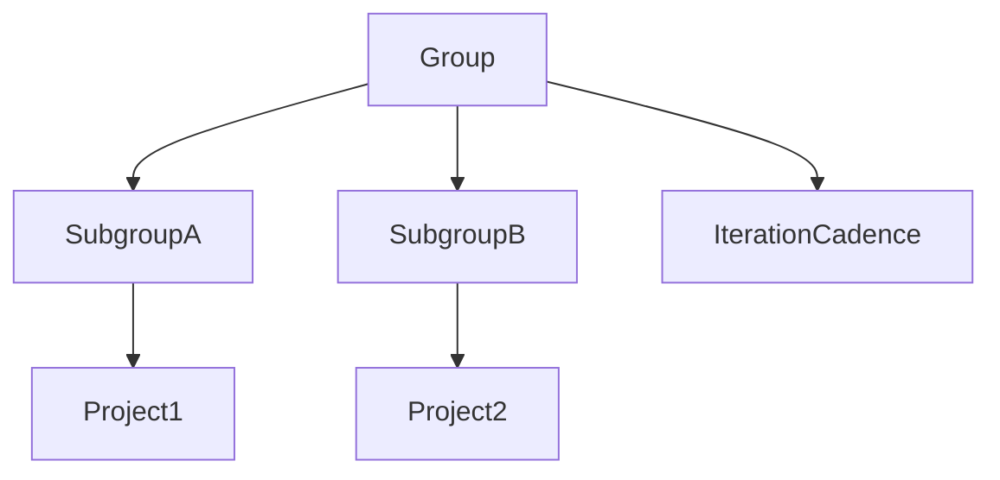

<!-- vale gitlab_base.FutureTense = NO -->

Pour exécuter une itération de développement Agile dans GitLab, vous utilisez plusieurs fonctionnalités GitLab qui fonctionnent ensemble.

Pour exécuter une itération Agile depuis GitLab :

1. Créez un groupe.
1. Créez un projet.
1. Configurez une cadence d'itération.
1. Créez des labels à portée limitée.
1. Créez vos epics et vos tickets.
1. Créez un tableau des tickets.

Une fois ces composants principaux créés, vous pouvez commencer à exécuter vos itérations.

## Créer un groupe {#create-a-group}

Les cadences d'itération sont créées pour un groupe. Commencez donc par [en créer un](../../user/group/_index.md#create-a-group) si vous n'en avez pas encore.

Les groupes vous permettent de gérer simultanément un ou plusieurs projets liés. Vous ajoutez vos utilisateurs en tant que membres du groupe et leur attribuez un rôle. Les rôles déterminent le [niveau de permissions](../../user/permissions.md) dont dispose chaque utilisateur sur les projets du groupe. L'appartenance se propage automatiquement à tous les sous-groupes et projets.

## Créer un projet {#create-a-project}

Maintenant, [créez un ou plusieurs projets](../../user/project/_index.md) dans votre groupe. Il existe plusieurs façons de créer un projet. Un projet contient votre code et vos pipelines, mais aussi les tickets utilisés pour planifier vos prochaines modifications de code.

## Configurer une cadence d'itération {#set-up-an-iteration-cadence}

Avant de commencer à créer des epics ou des tickets, créez une [cadence d'itération](../../user/group/iterations/_index.md#iteration-cadences). Les cadences d'itération contiennent les timeboxes d'itération individuelles et séquentielles pour la planification et le reporting de vos tickets.

Lors de la création d'une cadence d'itération, vous pouvez décider de gérer automatiquement les itérations ou de désactiver la planification automatisée pour [gérer les itérations manuellement](../../user/group/iterations/_index.md#create-an-iteration-manually).

À l'image de l'appartenance, les itérations se propagent dans la hiérarchie de vos groupes, sous-groupes et projets. Si votre équipe possède plusieurs groupes et projets, créez la cadence d'itération dans le groupe partagé le plus haut de la hiérarchie :

## Créer des labels à portée limitée {#create-scoped-labels}

Vous devez également [créer des labels à portée limitée](../../user/project/labels.md) dans le même groupe que celui où vous avez créé votre cadence d'itération. Les labels vous aident à organiser vos epics, tickets et merge requests, et à visualiser le flux des tickets dans les tableaux. Par exemple, vous pouvez utiliser des labels à portée limitée tels que `workflow::planning`, `workflow::ready for development`, `workflow::in development` et `workflow::complete` pour indiquer le statut d'un ticket. Vous pouvez également utiliser des labels à portée limitée pour indiquer le type de ticket ou d'epic, comme `type::feature`, `type::defect` et `type::maintenance`.

## Créer vos epics et tickets {#create-your-epics-and-issues}

Vous pouvez maintenant commencer à planifier vos itérations. Commencez par créer des [epics](../../user/group/epics/_index.md) dans le groupe où vous avez créé votre cadence d'itération, puis créez des [tickets](../../user/project/issues/_index.md) enfants dans un ou plusieurs de vos projets. Ajoutez des labels à chacun selon les besoins.

## Créer un tableau des tickets {#create-an-issue-board}

Les [tableaux des tickets](../../user/project/issue_board.md) vous aident à planifier vos prochaines itérations ou à visualiser le workflow de l'itération en cours. Les colonnes de liste peuvent être créées en fonction du label, du cessionnaire, de l'itération ou du jalon. Vous pouvez également filtrer le tableau selon plusieurs attributs et regrouper les tickets par epic.

Dans le groupe où vous avez créé votre cadence d'itération et vos labels, [créez un tableau des tickets](../../user/project/issue_board.md#create-an-issue-board) et nommez-le « Iteration Planning ». Ensuite, créez des listes pour chacune de vos itérations. Vous pouvez ensuite faire glisser des tickets de la liste « Open » vers les listes d'itération pour les planifier dans les prochaines itérations.

Pour visualiser le workflow des tickets de l'itération en cours, créez un autre tableau des tickets appelé « Current Iteration ». Lors de la création du tableau :

1. Sélectionnez **Configurer le tableau** ().
1. À côté de **Itération**, sélectionnez **Modifier**.
1. Dans la liste déroulante, sélectionnez **Itération actuelle**.
1. Sélectionnez **Enregistrer les modifications**.

Votre tableau n'affichera désormais que les tickets appartenant à l'itération en cours. Vous pouvez commencer à ajouter des listes pour chacun des labels `workflow::...` que vous avez créés précédemment.

Vous êtes maintenant prêt à commencer le développement.
