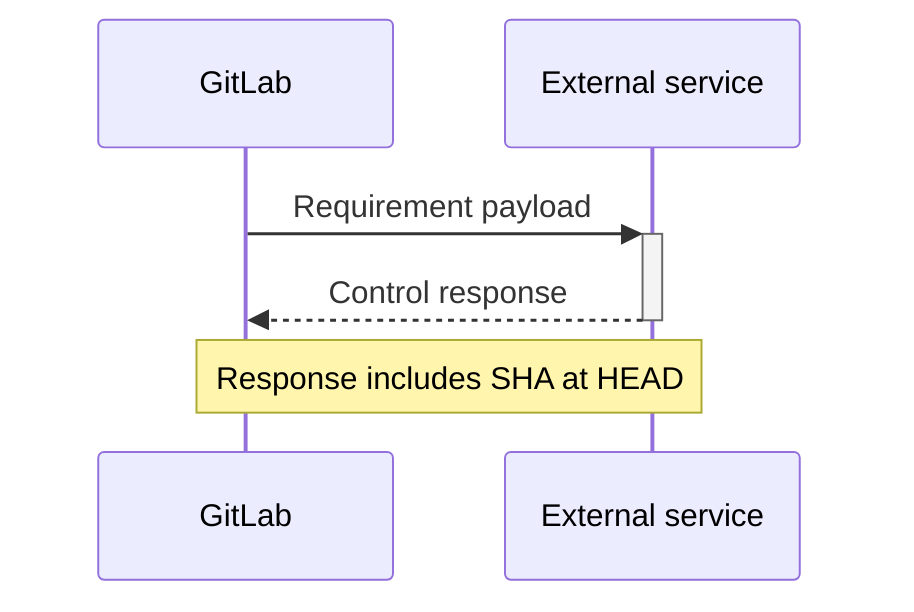



- Édition : GitLab Premium, GitLab Ultimate
- Offre : GitLab.com, GitLab Self-Managed, GitLab Dedicated



Vous pouvez créer un cadre de conformité qui est un label permettant d'identifier que votre projet a certaines exigences de conformité ou nécessite une supervision supplémentaire.

Dans l'édition Ultimate, le cadre de conformité peut éventuellement appliquer la [configuration du pipeline de conformité](../compliance_pipelines.md) et les [politiques de sécurité](../../application_security/policies/enforcement/_index.md#scope) aux projets sur lesquels il est appliqué.

Les cadres de conformité sont créés sur les groupes principaux. Si un projet est déplacé en dehors de son groupe principal existant, ses cadres sont supprimés.

Vous pouvez appliquer jusqu'à 20 cadres de conformité à chaque projet.

Pour une démonstration interactive, consultez [Cadres de conformité personnalisés](https://gitlab.navattic.com/custom-compliance).
<!-- Demo published on 2025-10-09 -->

## Prérequis {#prerequisites}

- Pour créer, modifier et supprimer des cadres de conformité, les utilisateurs doivent disposer de l'une des options suivantes :
  - Le rôle Propriétaire ou Responsable sécurité pour le groupe principal.
  - Se voir attribuer un [rôle personnalisé](../../custom_roles/_index.md) avec l'`admin_compliance_framework` [autorisation personnalisée](../../custom_roles/abilities.md#compliance-management).
- Pour ajouter ou supprimer un cadre de conformité dans un projet, le groupe auquel appartient le projet doit disposer d'un cadre de conformité.

## Créer un cadre de conformité à partir d'un modèle {#create-a-compliance-framework-from-a-template}



- Édition : GitLab Ultimate
- Offre : GitLab.com, GitLab Self-Managed, GitLab Dedicated





- [Introduction](https://gitlab.com/groups/gitlab-org/-/work_items/16808) dans GitLab 19.0 [avec le feature flag](../../../administration/feature_flags/_index.md) `compliance_framework_templates`. Fonctionnalité désactivée par défaut.
- [Passage en disponibilité générale](https://gitlab.com/gitlab-org/gitlab/-/merge_requests/239045) dans GitLab 19.1. Le feature flag `compliance_framework_templates` a été supprimé.



Au lieu de créer un cadre de conformité de zéro, vous pouvez en créer un à partir d'un modèle prédéfini prêt à l'emploi (OOTB). Les modèles incluent des exigences et des contrôles préconfigurés alignés sur les normes de conformité courantes, afin que vous puissiez démarrer rapidement sans configuration manuelle.

Les modèles suivants sont disponibles :

| Template | Description |
|----------|-------------|
| CIS CSC v8.1 | Cadre Center for Internet Security Controls v8.1 couvrant les contrôles de sécurité fondamentaux et organisationnels. |
| CSA CCM v4 | Cadre Cloud Security Alliance Cloud Controls Matrix v4 pour l'assurance de sécurité cloud. |
| Cyber Essentials | Programme Cyber Essentials soutenu par le gouvernement britannique couvrant cinq contrôles techniques clés. |
| DORA | Cadre Digital Operational Resilience Act pour la gestion des risques TIC dans le secteur financier. |
| FedRAMP High | Programme fédéral de gestion des risques et des autorisations (FedRAMP) – niveau High pour les services cloud fédéraux américains. |
| FedRAMP Low | Programme fédéral de gestion des risques et des autorisations (FedRAMP) – niveau Low pour les services cloud fédéraux américains. |
| FedRAMP Moderate | Programme fédéral de gestion des risques et des autorisations (FedRAMP) – niveau Moderate pour les services cloud fédéraux américains. |
| IRAP Official | Cadre de classification Official du programme australien d'évaluateurs accrédités en sécurité de l'information (IRAP). |
| IRAP Protected | Cadre de classification Protected du programme australien d'évaluateurs accrédités en sécurité de l'information (IRAP). |
| IRAP Secret | Cadre de classification Secret du programme australien d'évaluateurs accrédités en sécurité de l'information (IRAP). |
| IRAP Top Secret | Cadre de classification Top Secret du programme australien d'évaluateurs accrédités en sécurité de l'information (IRAP). |
| ISMAP | Cadre du programme japonais de gestion et d'évaluation de la sécurité des systèmes d'information (ISMAP). |
| ISO 27001:2022 | Norme internationale pour les systèmes de management de la sécurité de l'information. |
| NIS 2 | Cadre de la directive européenne 2 sur la sécurité des réseaux et de l'information pour les infrastructures critiques. |
| NIST 800-171 Rev. 3 CMMC | Cadre de certification du modèle de maturité en cybersécurité NIST SP 800-171 Révision 3. |
| NIST SP 800-218 | Cadre de développement logiciel sécurisé NIST (SSDF) v1.1. |
| NIST 800-53 Révision 5 | Contrôles de sécurité et de confidentialité NIST SP 800-53 Rév. 5 pour les systèmes d'information. |
| SOC 2 | Cadre System and Organization Controls 2 avec des exigences mappées aux principes COSO, couvrant l'analyse des vulnérabilités, les contrôles d'accès et la gestion des changements. |
| TISAX | Cadre Trusted Information Security Assessment Exchange pour les exigences de sécurité de l'information dans l'industrie automobile. |

### Créer un cadre à partir d'un modèle à l'aide de l'interface utilisateur {#create-a-framework-from-a-template-by-using-the-ui}

Pour créer un cadre de conformité à partir d'un modèle :

1. Dans la barre supérieure, sélectionnez **Rechercher ou accéder à**, puis recherchez votre groupe.
1. Dans la barre latérale gauche, sélectionnez **Sécuriser** > **Centre de conformité**.
1. Sur la page, sélectionnez l'onglet **Frameworks**.
1. Sélectionnez **Nouveau framework**.
1. Sélectionnez **Créer à partir d'un modèle**.
1. Parcourez les modèles disponibles et sélectionnez-en un pour prévisualiser ses exigences et ses contrôles.
1. Facultatif. Remplacez le **Nom**, la **Description** ou la **Couleur** pour personnaliser le cadre.
1. Facultatif. Sélectionnez **Définir par défaut** pour en faire le cadre par défaut du groupe.
1. Sélectionnez **Créer un framework**.

Le cadre est créé avec toutes les exigences et tous les contrôles du modèle préremplis. Vous pouvez ensuite modifier le cadre pour ajouter, supprimer ou modifier des exigences selon vos besoins.

Pour la création via l'API, consultez [Créer un cadre de conformité à partir d'un modèle](../../../api/graphql/compliance_frameworks.md#create-a-compliance-framework-from-a-template).

## Importer un cadre de conformité {#import-a-compliance-framework}



- [Introduit](https://gitlab.com/groups/gitlab-org/-/work_items/16499) dans GitLab 17.11.



Grâce à cette fonctionnalité, vous pouvez utiliser des cadres de conformité partagés ou sauvegardés. Le fichier JSON ne doit pas avoir le même nom qu'un cadre de conformité existant.

Une bibliothèque de modèles JSON est disponible dans le projet [Compliance Adherence Templates](https://gitlab.com/gitlab-org/software-supply-chain-security/compliance/engineering/compliance-adherence-templates). Ces modèles prédéfinis fournissent des cadres complets. Ils ne nécessitent aucune configuration manuelle et peuvent vous aider à démarrer rapidement.

### Importer un cadre de conformité prédéfini {#import-a-predefined-compliance-framework}

Pour importer un cadre de conformité prédéfini :

1. Accédez au projet [Compliance Adherence Templates](https://gitlab.com/gitlab-org/software-supply-chain-security/compliance/engineering/compliance-adherence-templates).
1. Parcourez les modèles de cadres disponibles et téléchargez le fichier JSON correspondant à votre cadre.
1. Dans la barre supérieure, sélectionnez **Rechercher ou accéder à**, puis recherchez votre groupe.
1. Dans la barre latérale gauche, sélectionnez **Sécuriser** > **Centre de conformité**.
1. Sur la page, sélectionnez l'onglet **Frameworks**.
1. Sélectionnez **Nouveau framework**.
1. Sélectionnez **Importer un framework**.
1. Dans la boîte de dialogue qui s'affiche, sélectionnez le fichier JSON depuis votre système local.
1. Si l'importation réussit, le nouveau cadre de conformité apparaît dans la liste.

Votre cadre est maintenant prêt à être appliqué aux projets. Consultez [Appliquer un cadre de conformité à un projet](#apply-a-compliance-framework-to-a-project).

### Importer un cadre de conformité à partir d'un fichier JSON {#import-a-compliance-framework-from-a-json-file}

Pour importer un cadre de conformité à l'aide d'un modèle JSON :

1. Dans la barre supérieure, sélectionnez **Rechercher ou accéder à**, puis recherchez votre groupe.
1. Dans la barre latérale gauche, sélectionnez **Sécuriser** > **Centre de conformité**.
1. Sur la page, sélectionnez l'onglet **Frameworks**.
1. Sélectionnez **Nouveau framework**.
1. Sélectionnez **Importer un framework**.
1. Dans la boîte de dialogue qui s'affiche, sélectionnez le fichier JSON depuis votre système local.

Si l'importation réussit, le nouveau cadre de conformité apparaît dans la liste. Les erreurs éventuelles sont affichées pour correction.

## Créer, modifier ou supprimer un cadre de conformité {#create-edit-or-delete-a-compliance-framework}

Vous pouvez créer, modifier ou supprimer un cadre de conformité en utilisant soit un rapport sur les cadres de conformité, soit un rapport sur les projets de conformité.

Pour plus d'informations sur l'utilisation d'un rapport sur les cadres de conformité, consultez :

- [Créer un nouveau cadre de conformité](../compliance_center/compliance_frameworks_report.md#create-a-new-compliance-framework).
- [Modifier un cadre de conformité](../compliance_center/compliance_frameworks_report.md#edit-a-compliance-framework).
- [Supprimer un cadre de conformité](../compliance_center/compliance_frameworks_report.md#delete-a-compliance-framework).

Pour plus d'informations sur l'utilisation d'un rapport sur les projets de conformité, consultez :

- [Créer un nouveau cadre de conformité](../compliance_center/compliance_projects_report.md#create-a-new-compliance-framework).
- [Modifier un cadre de conformité](../compliance_center/compliance_projects_report.md#edit-a-compliance-framework).
- [Supprimer un cadre de conformité](../compliance_center/compliance_projects_report.md#delete-a-compliance-framework). Les sous-groupes et les projets ont accès à tous les cadres de conformité créés sur leur groupe principal. Cependant, les cadres de conformité ne peuvent pas être créés, modifiés ou supprimés à l'aide de sous-groupes ou de projets. Les propriétaires de projets peuvent choisir un cadre à appliquer à leurs projets.

## Appliquer un cadre de conformité à un projet {#apply-a-compliance-framework-to-a-project}



- Application de plusieurs cadres de conformité [introduite](https://gitlab.com/groups/gitlab-org/-/epics/13294) dans GitLab 17.3.
- Application d'un cadre de conformité à un projet via un cadre de conformité [introduite](https://gitlab.com/groups/gitlab-org/-/epics/16747) dans GitLab 17.11.



Vous pouvez appliquer plusieurs cadres de conformité à un projet, mais vous ne pouvez pas appliquer des cadres de conformité à des projets dans des espaces de nommage personnels.

Pour appliquer un cadre de conformité à un projet, appliquez le cadre de conformité via le [rapport sur les projets de conformité](../compliance_center/compliance_projects_report.md#apply-a-compliance-framework-to-projects-in-a-group).

Vous pouvez utiliser l'[API GraphQL](../../../api/graphql/reference/_index.md#mutationprojectupdatecomplianceframeworks) pour appliquer un ou plusieurs cadres de conformité à un projet.

Si vous créez des cadres de conformité sur des sous-groupes avec GraphQL, le cadre est créé sur l'ancêtre racine si l'utilisateur dispose des autorisations adéquates. L'interface utilisateur GitLab présente une vue en lecture seule pour décourager ce comportement.

Pour appliquer un cadre de conformité à un projet via un cadre de conformité :

1. Dans la barre supérieure, sélectionnez **Rechercher ou accéder à**, puis recherchez votre groupe.
1. Dans la barre latérale gauche, sélectionnez **Sécuriser** > **Centre de conformité**.
1. Sur la page, sélectionnez l'onglet **Projets**.
1. Passez le curseur sur un cadre de conformité et sélectionnez l'onglet **Modifier le cadre**.
1. Sélectionnez la section **Projets**.
1. Sélectionnez des projets dans la liste.
1. Sélectionnez **Mettre à jour le cadre**.

## Cadres de conformité par défaut {#default-compliance-frameworks}

Les propriétaires de groupes peuvent définir un cadre de conformité par défaut. Le cadre par défaut est appliqué à tous les projets nouveaux et importés créés dans ce groupe. Il n'affecte pas le cadre appliqué aux projets existants. Le cadre par défaut ne peut pas être supprimé.

Un cadre de conformité défini par défaut possède un label `default`.

### Définir et supprimer un cadre par défaut à l'aide du centre de conformité {#set-and-remove-a-default-by-using-the-compliance-center}

Pour définir comme valeur par défaut (ou supprimer la valeur par défaut) depuis le [rapport sur les projets de conformité](../compliance_center/compliance_projects_report.md) :

1. Dans la barre supérieure, sélectionnez **Rechercher ou accéder à**, puis recherchez votre groupe.
1. Dans la barre latérale gauche, sélectionnez **Sécuriser** > **Centre de conformité**.
1. Sur la page, sélectionnez l'onglet **Projets**.
1. Passez le curseur sur un cadre de conformité et sélectionnez l'onglet **Modifier le cadre**.
1. Sélectionnez **Définir par défaut**.
1. Sélectionnez **Enregistrer les modifications**.

Pour définir comme valeur par défaut (ou supprimer la valeur par défaut) depuis le [rapport sur les cadres de conformité](../compliance_center/compliance_frameworks_report.md) :

1. Dans la barre supérieure, sélectionnez **Rechercher ou accéder à**, puis recherchez votre groupe.
1. Dans la barre latérale gauche, sélectionnez **Sécuriser** > **Centre de conformité**.
1. Sur la page, sélectionnez l'onglet **Frameworks**.
1. Passez le curseur sur un cadre de conformité et sélectionnez l'onglet **Modifier le cadre**.
1. Sélectionnez **Définir par défaut**.
1. Sélectionnez **Enregistrer les modifications**.

## Supprimer un cadre de conformité d'un projet {#remove-a-compliance-framework-from-a-project}

Pour supprimer un cadre de conformité d'un ou plusieurs projets dans un groupe, supprimez le cadre de conformité via le [rapport sur les projets de conformité](../compliance_center/compliance_projects_report.md#remove-a-compliance-framework-from-projects-in-a-group).

## Exporter un cadre de conformité en tant que fichier JSON {#export-a-compliance-framework-as-a-json-file}



- [Introduit](https://gitlab.com/groups/gitlab-org/-/work_items/16499) dans GitLab 17.11.



Grâce à cette fonctionnalité, vous pouvez partager et sauvegarder des cadres de conformité.

Pour exporter un cadre de conformité depuis le centre de conformité :

1. Dans la barre supérieure, sélectionnez **Rechercher ou accéder à**, puis recherchez votre groupe.
1. Dans la barre latérale gauche, sélectionnez **Sécuriser** > **Centre de conformité**.
1. Sur la page, sélectionnez l'onglet **Frameworks**.
1. Localisez le cadre de conformité que vous souhaitez exporter.
1. Sélectionnez l'ellipse verticale ().
1. Sélectionnez **Exporter en tant que fichier JSON**.

Le fichier JSON est téléchargé sur votre système local.

### Structure et schéma du modèle JSON {#json-template-structure-and-schema}

Les modèles JSON de cadres de conformité suivent une structure de schéma spécifique qui définit les métadonnées du cadre, les exigences et les contrôles associés. Comprendre cette structure vous aide à créer des modèles personnalisés ou à modifier des modèles existants pour répondre aux besoins de conformité spécifiques de votre organisation.

#### Propriétés du cadre {#framework-properties}

Chaque modèle JSON contient les propriétés de niveau supérieur suivantes :

| Propriété | Type | Obligatoire | Description |
|----------|------|----------|-------------|
| `name` | Chaîne | Oui | Nom d'affichage du cadre de conformité. |
| `description` | Chaîne | Oui | Description détaillée de l'objectif du cadre. |
| `color` | Chaîne | Oui | Code couleur hexadécimal pour le cadre (par exemple, `#1f75cb`). |
| `requirements` | Tableau | Non | Tableau d'objets d'exigences définissant les contrôles de conformité. |

#### Structure des exigences {#requirements-structure}

Chaque exigence dans le tableau `requirements` contient :

| Propriété | Type | Obligatoire | Description |
|----------|------|----------|-------------|
| `name` | Chaîne | Oui | Nom de l'exigence de conformité. |
| `description` | Chaîne | Oui | Description détaillée de ce que l'exigence impose. |
| `controls` | Tableau | Oui | Tableau d'objets de contrôle qui implémentent l'exigence. |

#### Structure du contrôle {#control-structure}

Chaque contrôle dans le tableau `controls` définit une vérification spécifique :

| Propriété | Type | Obligatoire | Description |
|----------|------|----------|-------------|
| `name` | Chaîne | Oui | Identifiant du contrôle GitLab (par exemple, `scanner_sast_running`). |
| `control_type` | Chaîne | Oui | Toujours `"internal"` pour les contrôles GitLab. |
| `expression` | Objet | Oui | Définit la logique d'évaluation du contrôle. |

#### Objet expression {#expression-object}

L'objet `expression` définit comment le contrôle est évalué :

| Propriété | Type | Obligatoire | Description |
|----------|------|----------|-------------|
| `field` | Chaîne | Oui | Nom du champ à évaluer (correspond au nom du contrôle). |
| `operator` | Chaîne | Oui | Opérateur de comparaison (`=`, `>=`, `<=`, `>`, `<`). |
| `value` | Mixte | Oui | Valeur attendue (booléen, nombre ou chaîne). |

#### Exemple de structure de modèle JSON {#example-json-template-structure}

Voici un exemple simplifié illustrant la structure complète :

```json
{
  "name": "Example Compliance Framework",
  "description": "Example framework demonstrating JSON structure",
  "color": "#1f75cb",
  "requirements": [
    {
      "name": "Security Scanning Requirement",
      "description": "Ensure security scanning is enabled for all projects",
      "controls": [
        {
          "name": "scanner_sast_running",
          "control_type": "internal",
          "expression": {
            "field": "scanner_sast_running",
            "operator": "=",
            "value": true
          }
        },
        {
          "name": "minimum_approvals_required_2",
          "control_type": "internal",
          "expression": {
            "field": "minimum_approvals_required",
            "operator": ">=",
            "value": 2
          }
        }
      ]
    }
  ]
}
```

## Exigences {#requirements}



- Édition : GitLab Ultimate
- Offre : GitLab.com, GitLab Self-Managed, GitLab Dedicated





- [Introduit](https://gitlab.com/gitlab-org/gitlab/-/merge_requests/186525) dans GitLab 17.11 [avec un feature flag](../../../administration/feature_flags/_index.md) nommé `enable_standards_adherence_dashboard_v2`. Activés par défaut.
- [Disponibilité générale](https://gitlab.com/gitlab-org/gitlab/-/issues/535563) dans GitLab 18.3. Le feature flag `enable_standards_adherence_dashboard_v2` a été supprimé.



Dans GitLab Ultimate, vous pouvez définir des **exigences** spécifiques pour un cadre de conformité. Les exigences sont composées d'un ou plusieurs contrôles, qui sont des vérifications de la configuration ou du comportement des projets auxquels le cadre est attribué. Chaque exigence comporte au maximum cinq contrôles.

Chaque contrôle inclut une logique que GitLab utilise lors des analyses planifiées ou déclenchées pour évaluer la conformité d'un projet. Pour plus de détails sur le suivi de la conformité, consultez le [rapport sur le statut de conformité](../compliance_center/compliance_status_report.md).

Vous pouvez utiliser des contrôles de conformité GitLab ou des contrôles externes pour les exigences du cadre.

### Contrôles de conformité GitLab {#gitlab-compliance-controls}



- Dans GitLab 18.7 et versions ultérieures, [les contrôles des scanners de sécurité ne nécessitent plus un pipeline réussi](https://gitlab.com/gitlab-org/gitlab/-/work_items/579849).



Les contrôles de conformité GitLab peuvent être utilisés dans les cadres de conformité GitLab. Les contrôles sont des vérifications de la configuration ou du comportement des projets auxquels un cadre de conformité est attribué.

Combinez les contrôles de conformité GitLab pour vous aider à respecter les [normes de conformité](compliance_standards.md).

> [!note]
> Les contrôles des scanners de sécurité qui vérifient la présence d'un scanner actif ne parviennent pas à détecter les scanners configurés dans des [pipelines enfants](../../../ci/pipelines/downstream_pipelines.md#parent-child-pipelines). Pour que ces contrôles réussissent, vous devez configurer les scanners de sécurité dans le pipeline parent. Pour plus d'informations, consultez le [ticket 595632](https://gitlab.com/gitlab-org/gitlab/-/work_items/595632).

<!-- Updates to control names must be reflected also in compliance_standards.md -->

| Nom du contrôle                                             | Identifiant du contrôle                                                 | Description |
|:---------------------------------------------------------|:-----------------------------------------------------------|:------------|
| Analyse de sécurité des API en cours                                     | `scanner_api_security_running`                             | Garantit que l'[analyse de sécurité des API](../../application_security/api_security/_index.md) est configurée et en cours d'exécution dans le pipeline de la branche par défaut du projet. |
| Au moins une approbation                                    | `minimum_approvals_required_1`                             | Garantit que les merge requests [requièrent au moins une approbation](../../project/merge_requests/approvals/_index.md) avant la fusion. |
| Au moins deux approbations                                   | `minimum_approvals_required_2`                             | Garantit que les merge requests [requièrent au moins deux approbations](../../project/merge_requests/approvals/_index.md) avant la fusion. |
| SSO d'authentification activé                                         | `auth_sso_enabled`                                         | Garantit que l'[authentification par authentification unique (SSO)](../../group/saml_sso/_index.md) est activée pour le projet. |
| L'approbation de la merge request par son auteur est interdite               | `merge_request_prevent_author_approval`                    | Garantit que l'auteur d'une merge request [ne peut pas approuver ses propres modifications](../../project/merge_requests/approvals/_index.md). |
| Suppression de branche désactivée                                 | `branch_deletion_disabled`                                 | Garantit que [les branches ne peuvent pas être supprimées](../../project/repository/branches/protected.md). |
| Portée du jeton de job CI/CD activée                            | `cicd_job_token_scope_enabled`                             | Garantit que les restrictions de portée du [jeton de job CI/CD](../../../ci/jobs/ci_job_token.md) sont activées. |
| Les modifications de code requièrent des propriétaires du code                         | `code_changes_requires_code_owners`                        | Garantit que les modifications de code requièrent l'approbation des [propriétaires du code](../../project/codeowners/_index.md). |
| Approbation du propriétaire du code requise                             | `code_owner_approval_required`                             | Garantit que le [fichier des propriétaires du code](../../project/codeowners/_index.md) est configuré. |
| Analyse de la qualité du code en cours                                     | `scanner_code_quality_running`                             | Garantit que l'[analyse de la qualité du code](../../../ci/testing/code_quality.md) est configurée et en cours d'exécution dans le pipeline de la branche par défaut du projet. |
| L'approbation de la merge request par ses contributeurs est interdite           | `merge_request_prevent_committers_approval`                | Garantit que les utilisateurs qui ont [contribué à une merge request ne peuvent pas l'approuver](../../project/merge_requests/approvals/_index.md). |
| Analyse des conteneurs en cours                               | `scanner_container_scanning_running`                       | Garantit que l'[analyse des conteneurs](../../application_security/container_scanning/_index.md) est configurée et en cours d'exécution dans le pipeline de la branche par défaut du projet. |
| DAST en cours                                             | `scanner_dast_running`                                     | Garantit que le [test dynamique de sécurité des applications (DAST)](../../application_security/dast/_index.md) est configuré et en cours d'exécution dans le pipeline de la branche par défaut du projet. |
| Branche par défaut protégée                                 | `default_branch_protected`                                 | Garantit que la branche par défaut dispose de [règles de protection](../../project/repository/branches/protected.md) activées. |
| Branche par défaut protégée contre les push directs                | `default_branch_protected_from_direct_push`                | [Empêche les push directs vers la branche par défaut](../../project/repository/branches/protected.md). |
| Les utilisateurs peuvent fusionner sur la branche par défaut                           | `default_branch_users_can_merge`                           | Contrôle [si les utilisateurs peuvent fusionner des modifications vers la branche par défaut](../../project/repository/branches/protected.md). |
| Les utilisateurs peuvent pousser sur la branche par défaut                            | `default_branch_users_can_push`                            | Contrôle [si les utilisateurs peuvent pousser directement vers la branche par défaut](../../project/repository/branches/protected.md). |
| Streaming des événements d'audit Duo Agentic Flow                  | `duo_agentic_flow_audit_events_streaming`                  | Garantit qu'une [destination de streaming des événements d'audit](../audit_event_streaming.md) active au niveau du groupe capture les événements de la plateforme GitLab Duo Agent. Réussit lorsque la plateforme Agent est désactivée pour le groupe. |
| Analyse des dépendances en cours                              | `scanner_dep_scanning_running`                             | Garantit que l'[analyse des dépendances](../../application_security/dependency_scanning/_index.md) est configurée et en cours d'exécution dans le pipeline de la branche par défaut du projet. **Note** : sur les instances GitLab Self-Managed (à partir de la version 18.4), ce contrôle peut échouer lors de l'utilisation de l'[analyse des dépendances basée sur le SBOM](../../application_security/dependency_scanning/dependency_scanning_sbom/_index.md) en raison de différences dans les artefacts. Consultez les [considérations de compatibilité](../../application_security/dependency_scanning/dependency_scanning_sbom/troubleshooting_ds_sbom_analyzer.md#compliance-framework-compatibility). |
| Garantir deux administrateurs par dépôt                 | `ensure_2_admins_per_repo`                                 | Garantit qu'[au moins deux Propriétaires](../../project/members/_index.md) sont attribués à chaque projet. |
| Suivi des erreurs activé                                   | `error_tracking_enabled`                                   | Garantit que le [suivi des erreurs](../../../operations/error_tracking.md) est activé pour le projet. |
| Push forcé désactivé                                      | `force_push_disabled`                                      | Empêche les [push forcés](../../project/repository/branches/protected.md) vers les dépôts. |
| Des duplications existent pour le projet                              | `has_forks`                                                | Garantit que le projet a été [dupliqué](../../project/repository/forking_workflow.md) |
| Niveau de licence GitLab Ultimate                            | `gitlab_license_level_ultimate`                            | Garantit que l'instance GitLab utilise une [licence Ultimate](https://about.gitlab.com/pricing/feature-comparison/). |
| Configuration CI/CD valide                            | `has_valid_ci_config`                                      | Garantit que le projet possède une [configuration CI/CD valide](../../../ci/yaml/_index.md). |
| Analyse IaC en cours                                     | `scanner_iac_running`                                      | Garantit que l'[analyse Infrastructure as Code (IaC)](../../application_security/iac_scanning/_index.md) est configurée et en cours d'exécution dans le pipeline de la branche par défaut du projet. |
| Visibilité interne interdite                         | `project_visibility_not_internal`                          | Garantit que les projets ne sont pas définis sur une [visibilité interne](../../public_access.md). |
| Suivi des tickets activé                                   | `issue_tracking_enabled`                                   | Garantit que le [suivi des tickets](../../project/issues/_index.md) est activé pour le projet. |
| Analyse de conformité des licences en cours                               | `scanner_license_compliance_running`                       | Garantit que l'[analyse de conformité des licences](../license_approval_policies.md) est configurée et en cours d'exécution dans le pipeline de la branche par défaut du projet. |
| Un commit sur une merge request réinitialise les approbations                    | `merge_request_commit_reset_approvals`                     | Garantit que [les nouveaux commits sur les merge requests réinitialisent les approbations](../../project/merge_requests/approvals/settings.md). |
| Les règles d'approbation des merge requests empêchent toute modification            | `merge_requests_approval_rules_prevent_editing`            | Garantit que les [règles d'approbation des merge requests](../../project/merge_requests/approvals/settings.md) ne peuvent pas être modifiées. |
| Les merge requests requièrent l'approbation du propriétaire du code               | `merge_requests_require_code_owner_approval`               | Garantit que les merge requests requièrent l'approbation des [propriétaires du code](../../project/codeowners/_index.md). |
| Niveau d'accès aux expériences de modèles ML configuré                | `model_experiments_access_level_configured`                | Garantit que les [expériences de modèles ML](../../project/ml/experiment_tracking/_index.md) sont réservées aux membres du projet uniquement. |
| Niveau d'accès au registre de modèles ML configuré                   | `model_registry_access_level_configured`                   | Garantit que le [registre de modèles ML](../../project/ml/model_registry/_index.md) est réservé aux membres du projet uniquement. |
| Plus de membres que d'administrateurs                                 | `more_members_than_admins`                                 | Garantit qu'un nombre inférieur d'administrateurs [(Propriétaires ou Mainteneurs)](../../project/members/_index.md) sont attribués au projet par rapport au nombre total de membres. |
| Aucune découverte Package Hunter non triée                     | `package_hunter_no_findings_untriaged`                     | Garantit que toutes les découvertes de [Package Hunter](../../application_security/triage/_index.md) sont triées. |
| Projet non archivé                                     | `project_archived`                                         | Vérifie si le [projet est archivé](../../project/settings/_index.md). Généralement, `false` est conforme. |
| Projet non marqué pour suppression                          | `project_marked_for_deletion`                              | Vérifie si le [projet est marqué pour suppression](../../project/settings/_index.md). `false` est conforme. |
| Pipelines du projet non publics                             | `project_pipelines_not_public`                             | Garantit que [les pipelines du projet ne sont pas visibles publiquement](../../../ci/pipelines/settings.md). Ne tient pas compte de la [visibilité du projet](../../public_access.md). |
| Le dépôt du projet existe                                | `project_repo_exists`                                      | Garantit qu'un [dépôt Git](../../../topics/git/_index.md) existe pour le projet. |
| Visibilité publique du projet non autorisée                            | `project_visibility_not_public`                            | Garantit que les projets ne sont pas définis sur une [visibilité publique](../../public_access.md). |
| Des branches protégées existent                                 | `protected_branches_set`                                   | Garantit que le projet contient des [branches protégées](../../project/repository/branches/protected.md). |
| Protection des push activée                                  | `push_protection_enabled`                                  | Garantit que la [protection des push de secrets](../../application_security/secret_detection/secret_push_protection/_index.md) est activée pour le projet. |
| Branche à jour requise                                | `require_branch_up_to_date`                                | Garantit que la [branche source est à jour avec la branche cible avant la fusion](../../project/merge_requests/methods/_index.md). |
| Historique linéaire requis                                   | `require_linear_history`                                   | Garantit un [historique de commits linéaire](../../project/merge_requests/methods/_index.md#fast-forward-merge) en interdisant les commits de fusion. |
| MFA requis au niveau de l'organisation                        | `require_mfa_at_org_level`                                 | Garantit que l'[authentification multifacteur](../../profile/account/two_factor_authentication.md) est requise au niveau de l'organisation. |
| MFA requis pour les contributeurs                             | `require_mfa_for_contributors`                             | Garantit que les [contributeurs ont l'authentification multifacteur activée](../../profile/account/two_factor_authentication.md). |
| Commits signés requis                                  | `require_signed_commits`                                   | Garantit que les [commits signés](../../project/repository/signed_commits) sont requis. |
| Réinitialisation des approbations lors d'un push                                  | `reset_approvals_on_push`                                  | Garantit que [les approbations sont réinitialisées lors de l'envoi de nouveaux commits](../../project/merge_requests/approvals/settings.md) vers la merge request. |
| Résolution des discussions requise                             | `resolve_discussions_required`                             | Garantit que [toutes les discussions doivent être résolues](../../discussions/_index.md) avant que la fusion soit autorisée. |
| Restreindre l'accès push/fusion                               | `restrict_push_merge_access`                               | Restreint les utilisateurs autorisés à pousser ou fusionner vers les [branches protégées](../../project/repository/branches/protected.md). |
| Accès restreint aux builds                                  | `restricted_build_access`                                  | Garantit un [accès restreint aux artefacts de build et aux sorties des pipelines](../../../ci/pipelines/settings.md). |
| Réviser et archiver les dépôts obsolètes                    | `review_and_archive_stale_repos`                           | Garantit que les dépôts obsolètes sont examinés et [archivés](../../project/settings/_index.md). |
| Réviser et supprimer les utilisateurs inactifs                         | `review_and_remove_inactive_users`                         | Garantit que les [utilisateurs inactifs](../../../administration/admin_area.md) sont examinés et supprimés. |
| SAST en cours                                             | `scanner_sast_running`                                     | Garantit que le [test statique de sécurité des applications](../../application_security/sast/_index.md) (SAST) est configuré et en cours d'exécution dans le pipeline de la branche par défaut du projet. |
| Détection des secrets en cours                                 | `scanner_secret_detection_running`                         | Garantit que l'[analyse de détection des secrets](../../application_security/secret_detection/_index.md) est configurée et en cours d'exécution dans le pipeline de la branche par défaut du projet. |
| Webhooks sécurisés                                          | `secure_webhooks`                                          | Garantit que les [webhooks](../../project/integrations/webhooks.md) sont configurés de manière sécurisée. |
| Nettoyage des branches obsolètes activé                             | `stale_branch_cleanup_enabled`                             | Garantit que le [nettoyage automatique des branches obsolètes](../../project/repository/branches/_index.md) est activé. |
| Vérifications de statut requises                                   | `status_checks_required`                                   | Garantit que les [vérifications de statut](../../project/merge_requests/status_checks.md) doivent réussir avant que la fusion soit autorisée. |
| Page de statut configurée                                   | `status_page_configured`                                   | Garantit qu'une [page de statut](../../../operations/incident_management/status_page.md) est configurée pour le projet. |
| Autorisations strictes pour le dépôt                         | `strict_permissions_for_repo`                              | Garantit que des [autorisations strictes](../../permissions.md) sont définies pour l'accès au dépôt. |
| Terraform activé                                        | `terraform_enabled`                                        | Garantit que l'[intégration Terraform](../../../administration/terraform_state.md) est activée pour le projet. |
| Variables CI/CD définies par l'utilisateur réservées aux mainteneurs   | `project_user_defined_variables_restricted_to_maintainers` | Garantit que seuls les utilisateurs disposant du rôle Mainteneur ou supérieur peuvent transmettre des [variables définies par l'utilisateur lors du déclenchement des pipelines](../../../ci/variables/_index.md). |
| Vulnérabilités dépassant le seuil SLO en jours                  | `vulnerabilities_slo_days_over_threshold`                  | Garantit que les [vulnérabilités sont traitées](../../application_security/vulnerabilities/_index.md) dans les délais SLO (180 jours). |

### Contrôles externes {#external-controls}



- Nom du contrôle externe [introduit](https://gitlab.com/gitlab-org/gitlab/-/merge_requests/192177) dans GitLab 18.1.



Les contrôles externes sont des appels API vers des systèmes externes qui demandent le statut d'un contrôle ou d'une exigence externe.

Vous pouvez créer un contrôle externe qui envoie des données à des outils tiers.

Lorsque les [analyses de conformité](../compliance_center/compliance_status_report.md#scan-timing-and-triggers) sont exécutées, GitLab envoie une notification. Les utilisateurs ou les workflows automatisés peuvent ensuite mettre à jour le statut du contrôle depuis l'extérieur de GitLab.

Grâce à cette intégration, vous pouvez vous connecter à des outils de workflow tiers, tels que ServiceNow, ou à l'outil personnalisé de votre choix. L'outil tiers répond avec un statut associé. Ce statut est ensuite affiché dans le [rapport sur le statut de conformité](../compliance_center/compliance_status_report.md).

Vous pouvez configurer des contrôles externes pour chaque projet individuel. Les contrôles externes ne sont pas partagés entre les projets. Les vérifications de statut échouent si un contrôle externe reste en état d'attente pendant plus de six heures.

#### Ajouter des contrôles externes {#add-external-controls}

Pour ajouter un contrôle externe lors de la création ou de la modification d'un cadre :

1. Dans la barre supérieure, sélectionnez **Rechercher ou accéder à**, puis recherchez votre groupe.
1. Dans la barre latérale gauche, sélectionnez **Sécuriser** > **Centre de conformité**.
1. Sur la page, sélectionnez l'onglet **Frameworks**.
1. Sélectionnez **Nouveau framework** ou modifiez un cadre existant.
1. Dans la section **Exigences**, sélectionnez **Nouvelle exigence**.
1. Sélectionnez **Ajouter un contrôle externe**.
1. Dans les champs, modifiez le **Nom du contrôle externe**, l'**URL externe** et le **secret partagé `HMAC`**.
1. Facultatif. Désactivez le bouton bascule **Ping activé** pour contrôler si GitLab envoie des notifications au service externe lors des analyses de conformité.
1. Sélectionnez **Enregistrer les modifications du cadriciel** pour enregistrer l'exigence.

#### Paramètre Ping activé {#ping-enabled-setting}



- [Introduction](https://gitlab.com/gitlab-org/gitlab/-/issues/538898) dans GitLab 18.5.



Le paramètre **Ping activé** contrôle si GitLab demande des mises à jour du statut des contrôles externes aux systèmes externes toutes les 12 heures.

- Activé (par défaut) : GitLab envoie automatiquement des requêtes HTTP à l'URL du service externe toutes les 12 heures et met à jour le statut du contrôle externe en fonction de la réponse.
- Désactivé : GitLab n'envoie pas de notifications au service externe et le contrôle externe affiche un badge **Désactivé** dans l'interface utilisateur du cadre de conformité. Pour demander le statut d'un contrôle externe, vous devez utiliser manuellement l'[API des contrôles externes](../../../api/external_controls.md).

#### Cycle de vie des contrôles externes {#external-control-lifecycle}

Les contrôles externes ont un workflow asynchrone. Les [analyses de conformité](../compliance_center/compliance_status_report.md#scan-timing-and-triggers) émettent un payload vers un service externe à chaque exécution.



Après réception du payload, le service externe peut exécuter les processus requis. Le service externe peut ensuite publier sa réponse dans la merge request en utilisant l'API REST.

Les contrôles externes peuvent avoir l'un des trois statuts suivants.

| Statut    | Description |
|:----------|:------------|
| `pending` | Statut par défaut. Aucune réponse reçue du service externe. |
| `pass`  | Réponse reçue du service externe et le contrôle externe a été approuvé par le service externe. |
| `fail`  | Réponse reçue du service externe et le contrôle externe a été refusé par le service externe. |

Si quelque chose change en dehors de GitLab, vous pouvez définir le [statut d'un contrôle externe à l'aide de l'API](../../../api/external_controls.md). Vous n'avez pas besoin d'attendre qu'un payload soit d'abord envoyé.

#### Exemple de payload de contrôle externe {#external-control-payload-example}

Lorsque GitLab envoie une notification à un service externe lors des analyses de conformité, il inclut des informations détaillées sur le projet dans le payload. Voici un exemple de la structure du payload JSON :

```json
{
  "id": 123456,
  "description": "Project for compliance testing and validation",
  "name": "Compliance Test Project",
  "name_with_namespace": "acme-corp / engineering / security / compliance-test-project",
  "path": "compliance-test-project",
  "path_with_namespace": "acme-corp/engineering/security/compliance-test-project",
  "created_at": "2024-01-15T10:30:00.000Z",
  "tag_list": ["compliance", "security"],
  "topics": ["governance", "audit"],
  "ssh_url_to_repo": "git@gitlab.com:acme-corp/engineering/security/compliance-test-project.git",
  "http_url_to_repo": "https://gitlab.com/acme-corp/engineering/security/compliance-test-project.git",
  "web_url": "https://gitlab.com/acme-corp/engineering/security/compliance-test-project",
  "avatar_url": "https://gitlab.com/uploads/-/system/project/avatar/123456/avatar.png",
  "star_count": 5,
  "last_activity_at": "2024-11-20T14:25:30.000Z",
  "visibility": "private",
  "namespace": {
    "id": 654321,
    "name": "Security Group",
    "path": "security",
    "kind": "group",
    "full_path": "acme-corp/engineering/security",
    "parent_id": 654320,
    "avatar_url": "https://gitlab.com/uploads/-/system/group/avatar/654321/avatar.png",
    "web_url": "https://gitlab.com/groups/acme-corp/engineering/security"
  },
  "container_registry_image_prefix": "registry.gitlab.com/acme-corp/engineering/security/compliance-test-project",
  "_links": {
    "self": "https://gitlab.com/api/v4/projects/123456",
    "issues": "https://gitlab.com/api/v4/projects/123456/issues",
    "merge_requests": "https://gitlab.com/api/v4/projects/123456/merge_requests",
    "repo_branches": "https://gitlab.com/api/v4/projects/123456/repository/branches",
    "labels": "https://gitlab.com/api/v4/projects/123456/labels",
    "events": "https://gitlab.com/api/v4/projects/123456/events",
    "members": "https://gitlab.com/api/v4/projects/123456/members",
    "cluster_agents": "https://gitlab.com/api/v4/projects/123456/cluster_agents"
  },
  "marked_for_deletion_at": null,
  "marked_for_deletion_on": null,
  "packages_enabled": true,
  "empty_repo": false,
  "archived": false,
  "resolve_outdated_diff_discussions": false,
  "container_expiration_policy": {
    "cadence": "1d",
    "enabled": false,
    "keep_n": 10,
    "older_than": "90d",
    "name_regex": ".*",
    "name_regex_keep": null,
    "next_run_at": "2024-01-16T10:30:00.000Z"
  },
  "repository_object_format": "sha1",
  "issues_enabled": true,
  "merge_requests_enabled": true,
  "wiki_enabled": true,
  "jobs_enabled": true,
  "snippets_enabled": true,
  "container_registry_enabled": true,
  "service_desk_enabled": true,
  "can_create_merge_request_in": false,
  "issues_access_level": "enabled",
  "repository_access_level": "enabled",
  "merge_requests_access_level": "enabled",
  "forking_access_level": "enabled",
  "wiki_access_level": "enabled",
  "builds_access_level": "enabled",
  "snippets_access_level": "enabled",
  "pages_access_level": "private",
  "analytics_access_level": "enabled",
  "container_registry_access_level": "enabled",
  "security_and_compliance_access_level": "private",
  "releases_access_level": "enabled",
  "environments_access_level": "enabled",
  "feature_flags_access_level": "enabled",
  "infrastructure_access_level": "enabled",
  "monitor_access_level": "enabled",
  "model_experiments_access_level": "enabled",
  "model_registry_access_level": "enabled",
  "package_registry_access_level": "enabled",
  "emails_disabled": false,
  "emails_enabled": true,
  "show_diff_preview_in_email": true,
  "shared_runners_enabled": true,
  "lfs_enabled": true,
  "creator_id": 111222,
  "import_status": "none",
  "open_issues_count": 3,
  "description_html": "<p>Project for compliance testing and validation</p>",
  "updated_at": "2024-11-20T14:25:30.000Z",
  "public_jobs": true,
  "shared_with_groups": [],
  "only_allow_merge_if_pipeline_succeeds": false,
  "allow_merge_on_skipped_pipeline": null,
  "request_access_enabled": true,
  "only_allow_merge_if_all_discussions_are_resolved": false,
  "remove_source_branch_after_merge": true,
  "printing_merge_request_link_enabled": true,
  "merge_method": "merge",
  "merge_request_title_regex": null,
  "merge_request_title_regex_description": null,
  "squash_option": "default_off",
  "enforce_auth_checks_on_uploads": true,
  "suggestion_commit_message": null,
  "merge_commit_template": null,
  "squash_commit_template": null,
  "issue_branch_template": null,
  "warn_about_potentially_unwanted_characters": true,
  "autoclose_referenced_issues": true,
  "max_artifacts_size": null,
  "approvals_before_merge": 0,
  "mirror": false,
  "external_authorization_classification_label": "",
  "requirements_enabled": true,
  "requirements_access_level": "enabled",
  "security_and_compliance_enabled": false,
  "compliance_frameworks": ["SOC 2 Compliance Framework"],
  "merge_pipelines_enabled": false,
  "merge_trains_enabled": false,
  "merge_trains_skip_train_allowed": false,
  "only_allow_merge_if_all_status_checks_passed": false,
  "allow_pipeline_trigger_approve_deployment": false,
  "prevent_merge_without_jira_issue": false,
  "auto_duo_code_review_enabled": false,
  "duo_remote_flows_enabled": true,
  "duo_foundational_flows_enabled": true,
  "spp_repository_pipeline_access": false,
  "project_control_compliance_status": {
    "status": "pending",
    "compliance_requirements_control_id": 100001,
    "project_id": 123456,
    "compliance_requirement_id": 200001,
    "namespace_id": 654321,
    "id": 300001,
    "created_at": "2024-11-26T10:00:00.000Z",
    "updated_at": "2024-11-26T10:00:00.000Z",
    "requirement_status_id": null
  }
}
```

Le service externe peut utiliser ces informations pour effectuer ses vérifications de conformité, puis répondre avec le statut de contrôle approprié en utilisant l'[API des contrôles externes](../../../api/external_controls.md).

### Ajouter des exigences {#add-requirements}

Pour ajouter une exigence lors de la création ou de la modification d'un cadre :

1. Dans la barre supérieure, sélectionnez **Rechercher ou accéder à**, puis recherchez votre groupe.
1. Dans la barre latérale gauche, sélectionnez **Sécuriser** > **Centre de conformité**.
1. Sur la page, sélectionnez l'onglet **Frameworks**.
1. Sélectionnez **Nouveau framework** ou modifiez un cadre existant.
1. Dans la section **Exigences**, sélectionnez **Nouvelle exigence**.
1. Dans la boîte de dialogue, ajoutez le **Nom** et la **Description**.
1. Sélectionnez **Ajouter un contrôle GitLab** pour ajouter d'autres contrôles.
1. Dans la liste déroulante de contrôles, recherchez et sélectionnez un contrôle.
1. Sélectionnez **Enregistrer les modifications du cadriciel** pour enregistrer l'exigence.

### Modifier les exigences {#edit-requirements}

Pour modifier une exigence lors de la création ou de la modification d'un cadre :

1. Dans la barre supérieure, sélectionnez **Rechercher ou accéder à**, puis recherchez votre groupe.
1. Dans la barre latérale gauche, sélectionnez **Sécuriser** > **Centre de conformité**.
1. Sur la page, sélectionnez l'onglet **Frameworks**.
1. Sélectionnez **Nouveau framework** ou modifiez un cadre existant.
1. Dans la section **Exigences**, sélectionnez **Action** > **Modifier**.
1. Dans la boîte de dialogue, modifiez le **Nom** et la **Description**.
1. Sélectionnez **Ajouter un contrôle GitLab** pour ajouter d'autres contrôles.
1. Dans la liste déroulante de contrôles, recherchez et sélectionnez un contrôle.
1. Sélectionnez  pour supprimer un contrôle.
1. Sélectionnez **Enregistrer les modifications du cadriciel** pour enregistrer l'exigence.

## Dépannage {#troubleshooting}

Lors de l'utilisation de cadres de conformité, vous pouvez rencontrer les problèmes suivants.

### Erreur : `Unable to determine the correct upload URL` {#error-unable-to-determine-the-correct-upload-url}

Vous rencontrerez cette erreur lors d'une [importation de cadre de conformité](#import-a-compliance-framework-from-a-json-file) si un cadre de conformité portant le même nom que le modèle JSON existe déjà.
