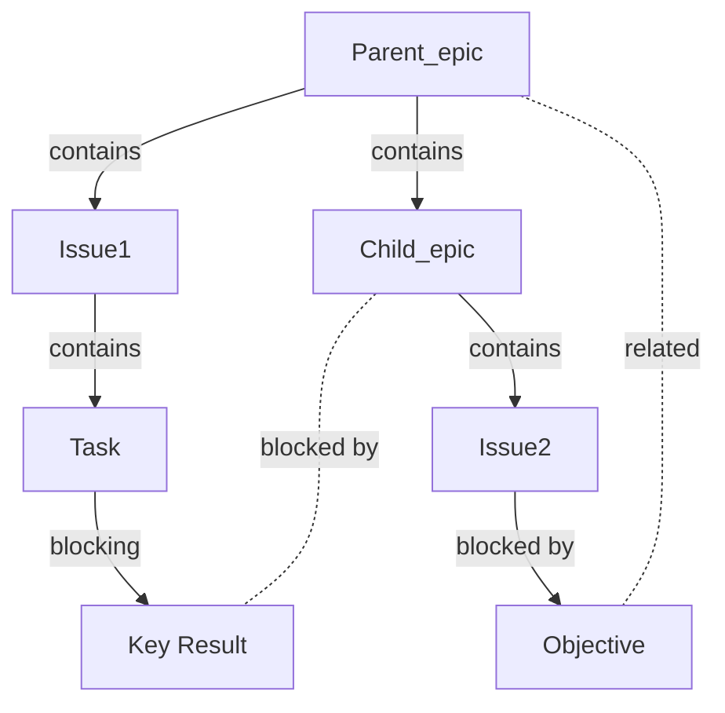



- Édition : GitLab Premium, GitLab Ultimate
- Offre : GitLab.com, GitLab Self-Managed, GitLab Dedicated



Les epics dans GitLab coordonnent et suivent les grandes initiatives en organisant les éléments de travail dans une hiérarchie de travail. Les epics rendent les projets complexes gérables. Ils permettent de :

- Décomposer les grandes fonctionnalités en livrables plus petits qui apportent une valeur incrémentale.
- Suivre l'avancement des éléments de travail associés avec des dates de début et de fin planifiées.
- Organiser les discussions et les décisions relatives à la portée des fonctionnalités et aux exigences.
- Créer des structures hiérarchiques qui relient les tâches aux objectifs stratégiques.
- Créer des roadmaps visuels pour surveiller l'avancement vers les objectifs.

Les équipes utilisent les epics pour se coordonner sur plusieurs itérations et suivre l'avancement vers les objectifs à long terme.

Dans l'édition Ultimate, les [epics imbriqués](../../work_items/child_items.md#work-with-multi-level-hierarchies) offrent une structure supplémentaire grâce à des hiérarchies de travail alignées sur les frameworks agiles. Décomposez les projets complexes en epics enfants plus gérables, qui peuvent eux-mêmes contenir leurs propres ensembles de tickets et de tâches. Cette structure imbriquée contribue à maintenir la clarté et garantit que tous les aspects d'un projet sont couverts sans perdre de vue les objectifs généraux.

  Voir la vidéo : <a href="https://www.youtube.com/watch?v=c0EwYYUZppw">GitLab Epics - Setting up your Organization with GitLab</a>.

<figure class="video-container">
  <iframe src="https://www.youtube-nocookie.com/embed/c0EwYYUZppw" frameborder="0" allowfullscreen> </iframe>
</figure>
<!-- Video published on 2023-10-30 -->

## Relations entre les epics et les autres éléments {#relationships-between-epics-and-other-items}

Les relations possibles entre les epics et les autres éléments sont les suivantes :

- Un epic est le parent d'un ou plusieurs tickets.
- Un epic est le parent d'un ou plusieurs [epics enfants](../../work_items/child_items.md#work-with-multi-level-hierarchies). GitLab Ultimate uniquement.
- Un epic est [lié](linked_epics.md) à une ou plusieurs tâches, objectifs ou résultats clés.

Exemple de relations :

### Tickets enfants issus de différentes hiérarchies de groupes {#child-issues-from-different-group-hierarchies}

Vous pouvez ajouter des tickets d'une hiérarchie de groupes différente à un epic. Pour ce faire, collez l'URL du ticket lors de l'[ajout d'un ticket existant](../../work_items/child_items.md#add-an-existing-issue-to-an-epic).

## Les epics comme éléments de travail {#epics-as-work-items}



- [Introduit](https://gitlab.com/groups/gitlab-org/-/work_items/9290) dans GitLab 17.2 [avec un feature flag](../../../administration/feature_flags/_index.md) nommé `work_item_epics`. Fonctionnalité désactivée par défaut. Introduit en [version bêta](../../../policy/development_stages_support.md#beta).
- [Activation sur GitLab.com](https://gitlab.com/gitlab-org/gitlab/-/issues/470685) dans GitLab 17.6.
- [Activé par défaut sur GitLab Self-Managed et GitLab Dedicated](https://gitlab.com/gitlab-org/gitlab/-/issues/468310) dans GitLab 17.7.
- [Passage en disponibilité générale](https://gitlab.com/gitlab-org/gitlab/-/issues/468310) dans GitLab 18.1. Suppression du feature flag `work_item_epics`.



Nous avons modifié l'apparence des epics en les faisant migrer vers un framework unifié pour les éléments de travail, afin de mieux répondre aux besoins produit de notre offre Agile Planning.

Pour plus d'informations, consultez l'[epic 9290](https://gitlab.com/groups/gitlab-org/-/work_items/9290) et les articles de blog suivants :

- [Premier aperçu : la nouvelle expérience de planification Agile dans GitLab](https://about.gitlab.com/blog/first-look-the-new-agile-planning-experience-in-gitlab/) (juin 2024)
- [Dévoilement d'une nouvelle expérience d'epic pour une planification Agile améliorée](https://about.gitlab.com/blog/unveiling-a-new-epic-experience-for-improved-agile-planning/) (juillet 2024)

Si vous rencontrez des problèmes lors de l'utilisation de cette modification, vous pouvez utiliser le [ticket de retour d'expérience](https://gitlab.com/gitlab-org/gitlab/-/issues/494462) pour fournir plus de détails.

### Référence Markdown des éléments de travail {#work-item-markdown-reference}



- [Introduction](https://gitlab.com/gitlab-org/gitlab/-/issues/352861) dans GitLab 18.1 [avec le feature flag](../../../administration/feature_flags/_index.md) `extensible_reference_filters`. Fonctionnalité désactivée par défaut.
- [En disponibilité générale](https://gitlab.com/gitlab-org/gitlab/-/merge_requests/197052) dans GitLab 18.2. Suppression du feature flag `extensible_reference_filters`.



Vous pouvez référencer des éléments de travail dans les champs Markdown GitLab avec `[work_item:123]`. Pour plus d'informations, consultez [les références spécifiques à GitLab](../../markdown.md#gitlab-specific-references).

## Sujets connexes {#related-topics}

- [Gérer les epics](manage_epics.md) et les epics enfants à plusieurs niveaux.
- Lier les [epics associés](linked_epics.md) en fonction d'un type de relation.
- Créer des workflows avec les [tableaux d'epics](epic_boards.md).
- [Activer les notifications](../../profile/notifications.md) pour les événements relatifs aux epics.
- [Ajouter une réaction emoji](../../emoji_reactions.md) à un epic ou à ses commentaires.
- Collaborer sur un epic en publiant des commentaires dans un [fil de discussion](../../discussions/_index.md).
- Utiliser l'[état de santé](manage_epics.md#health-status) pour suivre votre avancement.
- [Créer des modèles d'epic](../../project/description_templates.md#create-a-description-template) pour standardiser les descriptions d'epic.
