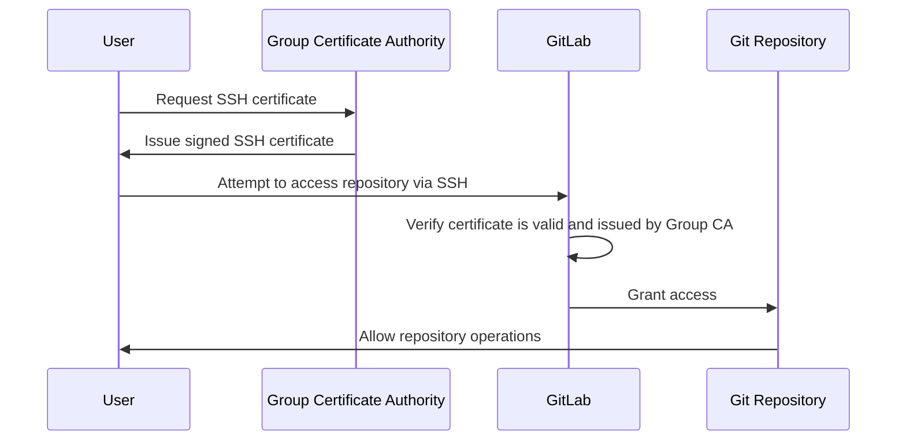



- Édition : GitLab Premium, GitLab Ultimate
- Offre : GitLab.com



Contrôlez et gérez l'accès Git à vos projets et groupes hébergés sur GitLab.com avec des certificats SSH.

Les certificats SSH sont des documents signés cryptographiquement qui authentifient l'identité et les permissions d'un utilisateur. Les certificats SSH sont émis par une autorité de certification (CA) de confiance et contiennent des informations telles que l'identité de l'utilisateur, la période de validité et les permissions.

Si vous êtes administrateur d'une instance GitLab Self-Managed, vous pouvez utiliser une approche de certificat SSH à l'échelle de l'instance. Choisissez l'une des méthodes suivantes :

- [Certificats SSH au niveau de l'instance avec `gitlab-sshd`](../../administration/operations/gitlab_sshd_ssh_certificates.md) : configurez les clés CA de confiance directement dans `gitlab-sshd` sans modifier le fichier `sshd_config` OpenSSH système.
- [Recherche d'utilisateur avec l'OpenSSH `AuthorizedPrincipalsCommand`](../../administration/operations/ssh_certificates.md) : configurez les certificats SSH à l'aide du démon OpenSSH système.

Les avantages de l'authentification par certificat SSH sont les suivants :

- Contrôle d'accès centralisé : vous pouvez gérer l'accès via une CA centrale, au lieu de clés SSH gérées individuellement par les utilisateurs.
- Sécurité renforcée : les certificats SSH sont plus sécurisés que les clés SSH traditionnelles.
- Accès limité dans le temps : vous pouvez configurer l'expiration des certificats après une période spécifique.
- Gestion simplifiée des identifiants : les organisations peuvent maintenir une liste d'identifiants de certificats SSH approuvés pour l'accès au dépôt.
- Indépendant des identifiants gérés par les utilisateurs : l'accès est contrôlé par des certificats gérés par le groupe, et non par les clés SSH publiques personnelles des utilisateurs.

## Certificats SSH et clés SSH {#ssh-certificates-and-ssh-keys}

Le tableau suivant compare les certificats SSH et les clés SSH :

| Fonctionnalité               | Certificats SSH                      | Clés SSH |
| --------------------- | ------------------------------------- | -------- |
| Contrôle d'accès        | Centralisé via une CA gérée par le groupe. | Distribué entre les comptes d'utilisateurs individuels. |
| Expiration            | Expiration intégrée.                  | Pas d'expiration intégrée. |
| Gestion des identifiants | Gérés par les propriétaires du groupe.              | Gérés par les utilisateurs individuels. |
| Complexité de configuration      | Configuration initiale plus complexe.           | Configuration initiale plus simple. |

## Flux d'authentification {#authentication-flow}

Le diagramme suivant illustre le fonctionnement de l'authentification par certificat SSH dans GitLab, depuis la demande d'un certificat jusqu'à l'accès à un dépôt :



Le processus d'authentification vérifie que les utilisateurs disposent de certificats SSH valides avant d'autoriser l'accès au dépôt.

## Ajouter un certificat CA à un groupe principal {#add-a-ca-certificate-to-a-top-level-group}



- [Introduction](https://gitlab.com/gitlab-org/gitlab/-/issues/421915) dans GitLab 16.4 [avec le feature flag](../../administration/feature_flags/list.md) `ssh_certificates_rest_endpoints`. Fonctionnalité désactivée par défaut.
- [Activé sur GitLab.com](https://gitlab.com/gitlab-org/gitlab/-/issues/424501) dans GitLab 16.9.
- [Disponible de manière générale](https://gitlab.com/gitlab-org/gitlab/-/issues/424501) dans GitLab 17.7. Le feature flag `ssh_certificates_rest_endpoints` a été supprimé.



Prérequis :

- Vous devez avoir le rôle Propriétaire pour le groupe.
- Le groupe doit être un groupe principal, et non un sous-groupe.

Pour ajouter un certificat CA à un groupe :

1. Générez une paire de clés SSH à utiliser comme fichier d'autorité de certification :

   ```plaintext
   ssh-keygen -f CA
   ```

1. Ajoutez la clé publique au groupe principal en utilisant l'[API des certificats SSH de groupe](../../api/group_ssh_certificates.md#add-a-group-ssh-certificate) pour accorder l'accès aux projets du groupe et de ses sous-groupes.

## Émettre des certificats CA pour les utilisateurs {#issue-ca-certificates-for-users}

Prérequis :

- Vous devez avoir le rôle Propriétaire pour le groupe.
- Les certificats utilisateur ne peuvent être utilisés que pour accéder aux projets du groupe principal et de ses sous-groupes.
- Le nom d'utilisateur ou l'adresse e-mail principale d'un utilisateur (`user` ou `user@example.com`) doit être spécifié pour associer un utilisateur GitLab au certificat utilisateur.
- L'utilisateur doit être un [utilisateur enterprise](../enterprise_user/_index.md).

Pour émettre des certificats utilisateur, utilisez la clé privée de la paire que vous avez [créée précédemment](#add-a-ca-certificate-to-a-top-level-group) :

```shell
ssh-keygen -s CA -I user@example.com -V +1d user-key.pub
```

La clé (`user-key.pub`) est la clé publique d'une paire de clés SSH utilisée par un utilisateur pour l'authentification SSH. La paire de clés SSH est soit générée par un utilisateur, soit provisionnée par l'infrastructure du propriétaire du groupe avec le certificat SSH.

La date d'expiration (`+1d`) indique la durée pendant laquelle le certificat SSH peut être utilisé pour accéder aux projets du groupe.

Les certificats utilisateur ne peuvent être utilisés que pour accéder aux projets du groupe principal.

### Principaux du certificat {#certificate-principals}

L'exemple `ssh-keygen` précédent ne définit aucun principal de certificat (option `-n`). Sans principaux, OpenSSH accepte le certificat pour tout utilisateur de connexion SSH. GitLab associe le certificat à un utilisateur avec la valeur d'identité (`-I`).

Si vous signez le certificat avec un ou plusieurs principaux, la liste doit inclure `git`, car les utilisateurs s'authentifient auprès de GitLab via SSH en tant qu'utilisateur `git` (par exemple, `git@gitlab.com`) :

```shell
ssh-keygen -s CA -I user@example.com -n git -V +1d user-key.pub
```

Si `git` est absent d'une liste de principaux non vide, GitLab rejette le certificat avec une erreur similaire à :

```plaintext
ssh: principal "git" not in the set of valid principals for given certificate: ["user@example.com"]
```

## Imposer les certificats SSH {#enforce-ssh-certificates}



- [Introduction](https://gitlab.com/gitlab-org/gitlab/-/issues/421915) dans GitLab 16.7 [avec le feature flag](../../administration/feature_flags/list.md) `enforce_ssh_certificates_via_settings`. Fonctionnalité désactivée par défaut.
- [Activé sur GitLab.com](https://gitlab.com/gitlab-org/gitlab/-/issues/426235) dans GitLab 16.9.
- [Disponible de manière générale](https://gitlab.com/gitlab-org/gitlab/-/issues/488635) dans GitLab 17.7. Le feature flag `enforce_ssh_certificates_via_settings` a été supprimé.



Vous pouvez imposer l'utilisation des certificats SSH et empêcher les utilisateurs de s'authentifier à l'aide de clés SSH et de jetons d'accès.

Lorsque les certificats SSH sont imposés :

- Seuls les comptes d'utilisateurs individuels sont concernés.
- Cette option ne s'applique pas aux comptes de service, aux clés de déploiement et aux autres types de comptes internes.
- Seuls les certificats SSH ajoutés au groupe par les propriétaires sont utilisés pour authentifier l'accès au dépôt.

> [!note]
> L'imposition des certificats SSH désactive l'accès HTTPS pour les utilisateurs normaux.

Prérequis :

- Vous devez avoir le rôle Propriétaire pour le groupe.

Pour imposer l'utilisation des certificats SSH :

1. Dans la barre supérieure, sélectionnez **Rechercher ou accéder à**, puis recherchez votre groupe.
1. Dans la barre latérale gauche, sélectionnez **Paramètres** > **Généralités**.
1. Développez la section **Permissions et fonctionnalités du groupe**.
1. Cochez la case **Imposer les certificats SSH**.
1. Sélectionnez **Enregistrer les modifications**.
