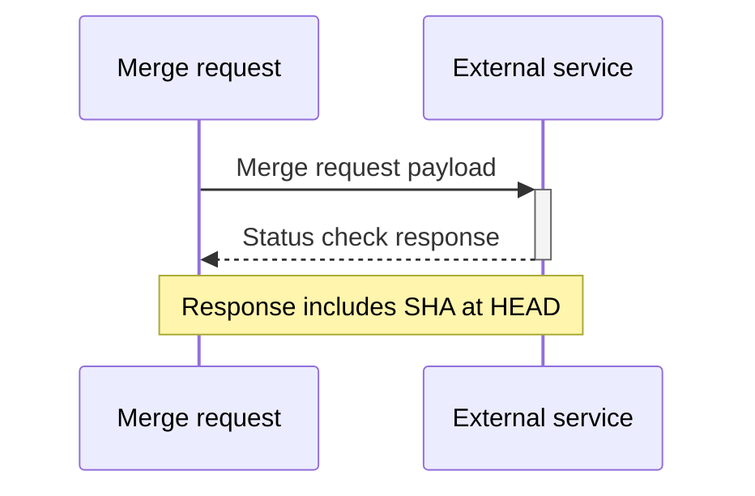



- Édition : GitLab Ultimate
- Offre : GitLab.com, GitLab Self-Managed, GitLab Dedicated



Les vérifications d'état sont des appels d'API vers des systèmes externes qui demandent le statut d'une exigence externe.

Vous pouvez créer une vérification d'état qui envoie des données de merge request à des outils tiers. Lorsque les utilisateurs créent, modifient ou ferment des merge requests, GitLab envoie une notification. Les utilisateurs ou les workflows automatisés peuvent alors mettre à jour le statut des merge requests depuis l'extérieur de GitLab.

Grâce à cette intégration, vous pouvez vous intégrer à des outils de workflow tiers, comme ServiceNow, ou à l'outil personnalisé de votre choix. L'outil tiers répond avec un statut associé. Ce statut est ensuite affiché sous forme de widget non bloquant dans la merge request, ce qui expose ce statut à l'auteur de la merge request ou aux relecteurs au niveau de la merge request elle-même.

Vous pouvez configurer les vérifications d'état des merge requests pour chaque projet individuel. Celles-ci ne sont pas partagées entre les projets.

Les vérifications d'état échouent si elles restent en attente pendant plus de deux minutes.

## Autorisations d'accès {#access-permissions}

Les réponses aux vérifications d'état externes peuvent être consultées par :

- Les utilisateurs ayant le rôle Reporter, Developer, Maintainer ou Owner dans le projet
- Tout utilisateur authentifié pouvant consulter la merge request lorsque le projet a une visibilité interne

Cela signifie que si vous avez un projet interne, tout utilisateur connecté pouvant accéder à la merge request peut consulter les réponses aux vérifications d'état externes.

Pour plus d'informations sur les cas d'utilisation, la découverte des fonctionnalités et les délais de développement, consultez [l'epic 3869](https://gitlab.com/groups/gitlab-org/-/epics/3869).

## Bloquer les fusions de merge requests à moins que toutes les vérifications d'état aient réussi {#block-merges-of-merge-requests-unless-all-status-checks-have-passed}

Par défaut, les merge requests dans les projets peuvent être fusionnées même si les vérifications d'état externes échouent. Pour bloquer la fusion des merge requests lorsque les vérifications externes échouent :

1. Dans la barre supérieure, sélectionnez **Rechercher ou accéder à**, puis recherchez votre projet.
1. Dans la barre latérale gauche, sélectionnez **Paramètres** > **Requêtes de fusion**.
1. Cochez la case **Les vérifications de statut doivent réussir**.
1. Sélectionnez **Enregistrer les modifications**.

## Cycle de vie {#lifecycle}

Les vérifications d'état externes ont un workflow asynchrone. Les merge requests émettent un payload de webhook de merge request vers un service externe chaque fois que :

- Une merge request est mise à jour, fermée, rouverte, approuvée, désapprouvée ou fusionnée.
- Du code est poussé vers la branche source de la merge request.



Lorsque le payload est reçu, le service externe peut alors exécuter tous les processus requis avant de renvoyer sa réponse à la merge request [via l'API REST](../../../api/status_checks.md#set-status-of-an-external-status-check).

Les merge requests renvoient une erreur `409 Conflict` pour toute réponse qui ne fait pas référence au `HEAD` actuel de la branche source. Par conséquent, il est sécurisé pour le service externe de traiter et de répondre à des commits obsolètes.

Les vérifications d'état externes ont les états suivants :

- `pending` - L'état par défaut. Aucune réponse n'a été reçue par la merge request de la part du service externe.
- `passed` - Une réponse du service externe a été reçue et approuvée par celui-ci.
- `failed` - Une réponse du service externe a été reçue et refusée par celui-ci.

Si quelque chose change en dehors de GitLab, vous pouvez [définir le statut d'une vérification d'état externe](../../../api/status_checks.md#set-status-of-an-external-status-check) via l'API. Vous n'avez pas besoin d'attendre qu'un payload de webhook de merge request soit envoyé au préalable.

## Afficher les services de vérification d'état {#view-status-check-services}

Pour afficher la liste des services de vérification d'état ajoutés à un projet depuis les paramètres de merge request :

1. Dans la barre supérieure, sélectionnez **Rechercher ou accéder à**, puis recherchez votre projet.
1. Dans la barre latérale gauche, sélectionnez **Paramètres** > **Requêtes de fusion**.
1. Faites défiler jusqu'à **Vérifications d'état**. Cette liste affiche le nom du service, l'URL de l'API, la branche ciblée et le statut d'authentification HMAC.


Vous pouvez également afficher la liste des services de vérification d'état depuis les paramètres des [règles de branche](../repository/branches/branch_rules.md#add-a-status-check-service).

## Ajouter ou mettre à jour un service de vérification d'état {#add-or-update-a-status-check-service}

### Ajouter un service de vérification d'état {#add-a-status-check-service}

Dans la sous-section **Vérifications d'état**, sélectionnez le bouton **Ajouter une vérification d'état**. Le formulaire **Ajouter une vérification d'état** s'affiche alors.


Remplir le formulaire et sélectionner le bouton **Ajouter une vérification d'état** crée une nouvelle vérification d'état.

La vérification d'état est appliquée à toutes les nouvelles merge requests, mais ne s'applique pas rétroactivement aux merge requests existantes.

### Mettre à jour un service de vérification d'état {#update-a-status-check-service}

Dans la sous-section **Vérifications d'état**, sélectionnez **Modifier** () en regard de la vérification d'état que vous souhaitez modifier. Le formulaire **Mettre à jour la vérification de l'état** s'affiche alors.


> [!note]
> Vous ne pouvez pas voir ni modifier la valeur du secret partagé HMAC. Pour modifier le secret partagé, supprimez et recréez la vérification d'état externe avec une nouvelle valeur pour le secret partagé.

Pour mettre à jour la vérification d'état, modifiez les valeurs dans le formulaire et sélectionnez **Mettre à jour la vérification de l'état**.

Les mises à jour des vérifications d'état sont appliquées à toutes les nouvelles merge requests, mais ne s'appliquent pas rétroactivement aux merge requests existantes.

### Valeurs du formulaire {#form-values}

Pour les erreurs de formulaire courantes, consultez la section [dépannage](#troubleshooting) ci-dessous.

#### Nom du service {#service-name}

Ce nom peut être toute valeur alphanumérique et doit être défini. Le nom doit être unique pour le projet.

#### API à vérifier {#api-to-check}

Ce champ nécessite une URL et doit utiliser le protocole HTTP ou HTTPS. Nous recommandons d'utiliser HTTPS pour protéger les données de vos merge requests en transit. L'URL doit être définie et doit être unique pour le projet.

#### Branche cible {#target-branch}

Si vous souhaitez restreindre la vérification d'état à une seule branche, vous pouvez utiliser ce champ pour définir cette limite.


La liste des branches est renseignée à partir des [branches protégées](../repository/branches/protected.md) du projet.

Vous pouvez faire défiler la liste des branches ou utiliser le champ de recherche lorsqu'il y a de nombreuses branches et que la branche que vous recherchez n'apparaît pas immédiatement. Le champ de recherche nécessite la saisie de trois caractères alphanumériques pour que la recherche commence.

Si vous souhaitez que la vérification d'état soit appliquée à toutes les merge requests, vous pouvez sélectionner l'option **Toutes les branches**.

#### Secret partagé HMAC {#hmac-shared-secret}

L'authentification HMAC empêche la falsification des requêtes et garantit qu'elles proviennent d'une source légitime.

## Supprimer un service de vérification d'état {#delete-a-status-check-service}

Dans la sous-section **Vérifications d'état**, sélectionnez **Supprimer** () en regard de la vérification d'état que vous souhaitez supprimer. La boîte de dialogue **Supprimer la vérification d'état ?** s'affiche alors.


Pour finaliser la suppression de la vérification d'état, vous devez sélectionner le bouton **Supprimer la vérification d'état**. Cette action supprime définitivement la vérification d'état et elle n'est pas récupérable.

## Widget des vérifications d'état {#status-checks-widget}

Le widget des vérifications d'état s'affiche dans les merge requests et présente les statuts suivants :

- **en attente** (), pendant que GitLab attend une réponse d'une vérification d'état externe.
- **réussi** () ou **en échec** (), lorsque GitLab reçoit une réponse d'une vérification d'état externe.

Lorsque des vérifications d'état sont en attente, le widget interroge les mises à jour toutes les quelques secondes jusqu'à ce qu'il reçoive une réponse **réussi** ou **en échec**.

Pour réessayer une vérification d'état en échec :

1. Dans la barre supérieure, sélectionnez **Rechercher ou accéder à**, puis recherchez votre projet.
1. Dans la barre latérale gauche, sélectionnez **Code** > **Requêtes de fusion** et repérez votre merge request.
1. Faites défiler jusqu'à la section des rapports de merge request et développez la liste déroulante pour afficher la liste des vérifications d'état externes.
1. Sélectionnez **Réessayer** () sur la ligne de la vérification d'état externe en échec. La vérification d'état est remise en état d'attente.

Une organisation peut avoir une politique qui n'autorise pas la fusion des merge requests si les vérifications d'état externes ne réussissent pas. Toutefois, les détails affichés dans le widget sont fournis à titre informatif uniquement.

> [!note]
> GitLab ne peut pas garantir que les vérifications d'état externes sont correctement traitées par le service externe concerné.

## Dépannage {#troubleshooting}

### Erreurs de valeur en double {#duplicate-value-errors}

```plaintext
Name is already taken
---
External API is already in use by another status check
```

Par projet, les vérifications d'état ne peuvent utiliser un nom ou une URL d'API qu'une seule fois. Ces erreurs signifient que le nom ou l'URL d'API de la vérification d'état a déjà été utilisé dans les vérifications d'état de ce projet.

Vous devez soit choisir une valeur différente pour la vérification d'état actuelle, soit mettre à jour la valeur de la vérification d'état existante.

### Erreur d'URL non valide {#invalid-url-error}

```plaintext
Please provide a valid URL
```

Le champ API à vérifier exige que l'URL fournie utilise le protocole HTTP ou HTTPS. Vous devez mettre à jour la valeur du champ pour satisfaire à cette exigence.

### Erreur de liste de branches lors de la récupération ou de la recherche {#branch-list-error-during-retrieval-or-search}

```plaintext
Unable to fetch branches list, please close the form and try again
```

Une réponse inattendue a été reçue de l'API de récupération des branches. Comme suggéré, vous devez fermer le formulaire et le rouvrir, ou actualiser la page. Cette erreur devrait être temporaire, mais si elle persiste, consultez la [page de statut GitLab](https://status.gitlab.com/) pour vérifier s'il y a une panne plus large.

### Échec du chargement des vérifications d'état {#failed-to-load-status-checks}

```plaintext
Failed to load status checks
```

Une réponse inattendue a été reçue de l'API des vérifications d'état externes. Vous devez :

- Actualiser la page au cas où cette erreur serait temporaire.
- Consulter la [page de statut GitLab](https://status.gitlab.com/) si le problème persiste, pour vérifier s'il y a une panne plus large.

## Sujets connexes {#related-topics}

- [API des vérifications d'état externes](../../../api/status_checks.md)
