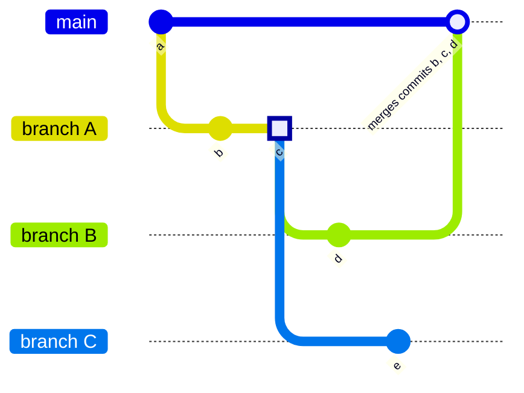



- Édition : Gratuite, GitLab Premium, GitLab Ultimate
- Offre : GitLab.com, GitLab Self-Managed, GitLab Dedicated



Les branches permettent de structurer et d'isoler les tâches de développement de votre équipe. Lorsque plusieurs personnes travaillent simultanément sur différentes fonctionnalités, les branches empêchent les modifications d'entrer en conflit. Chaque branche constitue un espace de travail isolé dans lequel vous implémentez de nouvelles fonctionnalités, corrigez des bugs ou expérimentez des idées.

Avec les branches, votre équipe peut :

- Travailler sur des fonctionnalités distinctes sans perturber la base de code principale.
- Examiner les modifications proposées avant qu'elles n'affectent le reste du projet.
- Annuler des modifications problématiques sans affecter les autres travaux en cours.
- Déployer des modifications en production de manière contrôlée et prévisible.

Le flux de travail de développement pour les branches est le suivant :

1. [Créez une branche](#create-a-branch) et ajoutez-y des commits. Pour simplifier ce processus, vous devez suivre les [modèles de nommage des branches](#prefix-branch-names-with-a-number).
1. Lorsque le travail est prêt pour la revue, créez une [merge request](../../merge_requests/_index.md) pour proposer la fusion des modifications de votre branche.
1. Prévisualisez les modifications avec un [environnement éphémère](../../../../ci/review_apps/_index.md).
1. [Demandez une revue](../../merge_requests/reviews/_index.md#request-a-review).
1. Une fois votre merge request approuvée, fusionnez votre branche dans la branche d'origine. La [méthode de fusion](../../merge_requests/methods/_index.md) détermine comment les merge requests sont traitées dans votre projet.
1. Une fois le contenu de votre branche fusionné, [supprimez la branche fusionnée](#delete-merged-branches).

## Voir toutes les branches {#view-all-branches}

Pour afficher et gérer vos branches dans l'interface utilisateur de GitLab :

1. Dans la barre supérieure, sélectionnez **Rechercher ou accéder à**, puis recherchez votre projet.
1. Dans la barre latérale gauche, sélectionnez **Code** > **Branches**.

Sur cette page, vous pouvez :

- Voir toutes les branches, ou filtrer l'affichage pour ne voir que les branches actives ou obsolètes.

  Une branche est considérée comme active si un commit y a été effectué au cours des trois derniers mois. Dans le cas contraire, elle est considérée comme obsolète.

- [Créer de nouvelles branches](#create-a-branch).
- [Supprimer les branches fusionnées](#delete-merged-branches).
- Voir les liens de merge request pointant vers la branche par défaut.

  Les branches dont les merge requests ne pointent pas vers la branche par défaut affichent le bouton  **Nouvelle** de merge request.

- [Afficher les règles de branche](branch_rules.md#view-branch-rules).
- Voir le statut du dernier pipeline sur la branche.

## Créer une branche {#create-a-branch}

Prérequis :

- Vous devez disposer du rôle Développeur, Chargé de maintenance ou Propriétaire pour le projet.

Pour créer une nouvelle branche depuis l'interface utilisateur de GitLab :

1. Dans la barre supérieure, sélectionnez **Rechercher ou accéder à**, puis recherchez votre projet.
1. Dans la barre latérale gauche, sélectionnez **Code** > **Branches**.
1. Dans le coin supérieur droit, sélectionnez **Nouvelle branche**.
1. Saisissez un **Nom de la branche**.
1. Dans **Créer à partir de**, sélectionnez la base de votre branche : une branche existante, une étiquette existante ou un SHA de commit.
1. Sélectionnez **Créer une branche**.

### Dans un projet vide {#in-a-blank-project}

Un [projet vide](../../_index.md#create-a-blank-project) ne contient pas de branche, mais vous pouvez en ajouter une.

Prérequis :

- Vous devez disposer du rôle Développeur, Chargé de maintenance ou Propriétaire pour le projet.
- Si vous ne disposez pas du rôle Chargé de maintenance ou Propriétaire, la [protection de la branche par défaut](../../../group/manage.md#change-the-default-branch-protection-of-a-group) doit être définie sur `Partially protected` ou `Not protected` pour que vous puissiez pousser un commit vers la branche par défaut.

Pour ajouter une [branche par défaut](default.md) à un projet vide :

1. Dans la barre supérieure, sélectionnez **Rechercher ou accéder à**, puis recherchez votre projet.
1. Faites défiler jusqu'à **Le dépôt de ce projet est vide** et sélectionnez le type de fichier que vous souhaitez ajouter.
1. Dans le Web IDE, apportez les modifications souhaitées à ce fichier, puis sélectionnez **Créer une validation**.
1. Saisissez un message de commit, puis sélectionnez **Commit**.

GitLab crée une branche par défaut et y ajoute votre fichier.

### À partir d'un ticket {#from-an-issue}

Lorsque vous consultez un ticket, vous pouvez créer une branche associée directement depuis cette page. Les branches créées de cette manière utilisent le [modèle par défaut pour les noms de branches issus des tickets](#configure-default-pattern-for-branch-names-from-issues), y compris les variables.

Prérequis :

- Vous devez disposer du rôle Développeur, Chargé de maintenance ou Propriétaire pour le projet.

Pour créer une branche à partir d'un ticket :

1. Dans la barre supérieure, sélectionnez **Rechercher ou accéder à**, puis recherchez votre projet.
1. Dans la barre latérale gauche, sélectionnez **Forfait** > **Éléments de travail**, puis filtrez par **Type** = **Ticket** et sélectionnez votre ticket.
1. Sous la description du ticket, sélectionnez **Créer une requête de fusion**  pour afficher la liste déroulante.
1. Sélectionnez **Créer une branche**.
1. Dans la boîte de dialogue, dans la liste déroulante **Source (branche ou étiquette)**, sélectionnez une branche source ou une étiquette.
1. Vérifiez le nom de branche suggéré. Il est basé sur le [modèle de nom de branche par défaut](#configure-default-pattern-for-branch-names-from-issues) de votre projet.
1. Facultatif. Si vous devez utiliser un nom de branche différent, saisissez-le dans la zone de texte **Nom de la branche**.
1. Sélectionnez **Créer une branche**.

Pour en savoir plus sur la création de branches dans des dépôts vides, consultez [le comportement des dépôts vides](#empty-repository-behavior).

Si le nom de la branche créée est [préfixé par le numéro du ticket](#prefix-branch-names-with-a-number), GitLab crée des références croisées entre le ticket et la merge request associée.

### À partir d'une tâche {#from-a-task}

Prérequis :

- Vous devez disposer du rôle Développeur, Chargé de maintenance ou Propriétaire pour le projet.

Pour créer une branche directement à partir d'une tâche :

1. Dans la barre supérieure, sélectionnez **Rechercher ou accéder à**, puis recherchez votre projet.
1. Dans la barre latérale gauche, sélectionnez **Forfait** > **Éléments de travail**, puis filtrez par **Type** = **Tâche** et sélectionnez votre tâche.
1. Sous la description de la tâche, sélectionnez **Créer une requête de fusion**  pour afficher la liste déroulante.
1. Sélectionnez **Créer une branche**.
1. Dans la boîte de dialogue, dans la liste déroulante **Branche ou étiquette source**, sélectionnez une branche source ou une étiquette.
1. Vérifiez le nom de branche suggéré. Il est basé sur le [modèle de nom de branche par défaut](#configure-default-pattern-for-branch-names-from-issues) de votre projet.
1. Facultatif. Si vous devez utiliser un nom de branche différent, saisissez-le dans la zone de texte **Nom de la branche**.
1. Sélectionnez **Créer une branche**.

Pour en savoir plus sur la création de branches dans des dépôts vides, consultez [le comportement des dépôts vides](#empty-repository-behavior).

Si le nom de la branche créée est [préfixé par le numéro de la tâche](#prefix-branch-names-with-a-number), GitLab crée des références croisées entre le ticket et la merge request associée.

### Comportement des dépôts vides {#empty-repository-behavior}

Si votre dépôt Git est vide, GitLab :

- Crée une branche par défaut.
- Effectue un commit d'un fichier `README.md` vide.
- Crée une nouvelle branche basée sur le titre du ticket et vous y redirige.
- Si votre projet est [configuré avec un service de déploiement](../../integrations/_index.md) tel que Kubernetes, GitLab vous invite à configurer le [déploiement automatique](../../../../topics/autodevops/stages.md#auto-deploy) en vous aidant à créer un fichier `.gitlab-ci.yml`.

## Nommer votre branche {#name-your-branch}

Git applique des [règles de nommage des branches](https://git-scm.com/docs/git-check-ref-format) pour garantir la compatibilité des noms de branches avec les autres outils. GitLab ajoute des exigences supplémentaires pour les noms de branches et offre des avantages pour les noms de branches bien structurés.

GitLab applique ces règles supplémentaires sur toutes les branches :

- Les espaces ne sont pas autorisés dans les noms de branches.
- Les noms de branches composés de 40 caractères hexadécimaux sont interdits, car ils ressemblent aux hachages de commits Git.
- Les noms de branches sont sensibles à la casse.

Les noms de branches avec un formatage spécifique offrent :

- Un flux de travail de merge request simplifié lorsque vous [préfixez les noms de branches avec des numéros de tickets](#prefix-branch-names-with-a-number).
- Des [protections de branches](protected.md) automatisées basées sur le nom de la branche.
- Des [règles de push](../push_rules.md) pour tester les noms de branches avant qu'ils ne soient poussés vers GitLab.
- Un contrôle sur les [jobs CI/CD](../../../../ci/jobs/_index.md) qui s'exécutent sur les merge requests.

### Packages logiciels {#software-packages}

Les packages logiciels courants, comme Docker, peuvent imposer des [restrictions supplémentaires sur le nommage des branches](../../../../administration/packages/container_registry_troubleshooting.md#docker-connection-error).

Pour une compatibilité optimale avec d'autres packages logiciels, utilisez uniquement :

- Des chiffres
- Des traits d'union (`-`)
- Des underscores (`_`)
- Des lettres minuscules de la table ASCII standard

### Caractères à éviter dans les noms de branches {#characters-to-avoid-in-branch-names}

Bien que Git autorise techniquement de nombreux caractères dans les noms de branches, certains caractères peuvent poser des problèmes avec GitLab Runner et d'autres outils et ne sont pas recommandés :

- Espaces et caractères d'espacement
- Caractères spéciaux de chemin ou de glob (joker) : `~`, `^`, `:`, `?`, `*`, `[`, `\`, `'`, `"`
- Double point : `..`
- Syntaxe Git spéciale : `@{`
- Barres obliques consécutives : `//`
- emoji
- Suffixe final `.` ou `.lock`
- Commençant par `-` ou `.`
- Caractères de contrôle ASCII (y compris Delete)

Pour une compatibilité maximale avec GitLab Runner et d'autres outils, utilisez uniquement des caractères alphanumériques, des traits d'union et des underscores.

### Configurer le modèle par défaut pour les noms de branches issus des tickets {#configure-default-pattern-for-branch-names-from-issues}

Par défaut, GitLab utilise le modèle `%{id}-%{title}` lors de la création d'une branche à partir d'un ticket, mais vous pouvez modifier ce modèle.

Prérequis :

- Vous devez disposer du rôle Chargé de maintenance ou Propriétaire dans le projet.

Pour modifier le modèle par défaut pour les branches créées à partir de tickets :

1. Dans la barre supérieure, sélectionnez **Rechercher ou accéder à**, puis recherchez votre projet.
1. Dans la barre latérale gauche, sélectionnez **Paramètres** > **Dépôt**.
1. Développez **Paramètres par défaut des branches**.
1. Faites défiler jusqu'à **Modèle de nom de branche** et saisissez une valeur. Le champ prend en charge ces variables :
   - `%{id}` : l'identifiant numérique du ticket.
   - `%{title}` : le titre du ticket, modifié pour n'utiliser que des caractères acceptables dans les noms de branches Git.
   - `%{branch_creator}` : le nom d'utilisateur de la personne qui crée la branche, modifié pour n'utiliser que des caractères acceptables dans les noms de branches Git.
1. Sélectionnez **Enregistrer les modifications**.

### Préfixer les noms de branches avec un numéro {#prefix-branch-names-with-a-number}

Pour simplifier la création de merge requests, commencez le nom de votre branche Git par le numéro du ticket ou de la tâche, suivi d'un trait d'union. Par exemple, pour associer une branche au ticket `#123`, commencez le nom de la branche par `123-`.

La branche doit se trouver dans le même projet que le ticket ou la tâche.

GitLab utilise ce numéro pour importer des données dans la merge request :

- L'élément est marqué comme associé à la merge request, et des liens réciproques sont affichés.
- La branche est connectée au ticket ou à la tâche.
- Si votre projet est configuré avec un [modèle de fermeture par défaut](../../issues/managing_issues.md#default-closing-pattern), la fusion de la merge request [ferme automatiquement](../../issues/managing_issues.md#closing-issues-automatically) le ticket associé.
- Si la merge request se trouve dans le même projet et n'est pas une duplication, le jalon et les labels du ticket sont copiés dans la merge request.

## Gérer et protéger les branches {#manage-and-protect-branches}

GitLab propose plusieurs méthodes pour protéger les branches individuelles. Ces méthodes garantissent que vos branches font l'objet d'une supervision et de contrôles qualité, de leur création à leur suppression. Pour afficher et modifier les protections de branches, consultez les [règles de branche](branch_rules.md).

### Télécharger les comparaisons de branches {#download-branch-comparisons}



- [Introduction](https://gitlab.com/gitlab-org/gitlab/-/issues/217206) dans GitLab 18.3.



Vous pouvez télécharger la comparaison entre les branches sous forme de fichier diff ou patch pour une utilisation en dehors de GitLab.

#### En tant que diff {#as-a-diff}

Pour télécharger la comparaison de branches sous forme de diff, ajoutez `format=diff` à l'URL de comparaison :

- Si l'URL ne contient pas de paramètres de requête, ajoutez `?format=diff` :

  ```plaintext
  https://gitlab.example.com/my-group/my-project/-/compare/main...feature-branch?format=diff
  ```

- Si l'URL contient déjà des paramètres de requête, ajoutez `&format=diff` :

  ```plaintext
  https://gitlab.example.com/my-group/my-project/-/compare/main...feature-branch?from_project_id=2&format=diff
  ```

Pour télécharger et appliquer le diff :

```shell
curl "https://gitlab.example.com/my-group/my-project/-/compare/main...feature-branch?format=diff" | git apply
```

#### En tant que fichier patch {#as-a-patch-file}

Pour télécharger la comparaison de branches sous forme de fichier patch, ajoutez `format=patch` à l'URL de comparaison :

- Si l'URL ne contient pas de paramètres de requête, ajoutez `?format=patch` :

  ```plaintext
  https://gitlab.example.com/my-group/my-project/-/compare/main...feature-branch?format=patch
  ```

- Si l'URL contient déjà des paramètres de requête, ajoutez `&format=patch` :

  ```plaintext
  https://gitlab.example.com/my-group/my-project/-/compare/main...feature-branch?from_project_id=2&format=patch
  ```

Pour télécharger et appliquer le patch en utilisant [`git am`](https://git-scm.com/docs/git-am) :

```shell
# Download and preview the patch
curl "https://gitlab.example.com/my-group/my-project/-/compare/main...feature-branch?format=patch" > changes.patch
git apply --check changes.patch

# Apply the patch
git am changes.patch
```

Vous pouvez également télécharger et appliquer le patch en une seule commande :

```shell
curl "https://gitlab.example.com/my-group/my-project/-/compare/main...feature-branch?format=patch" | git am
```

## Supprimer les branches fusionnées {#delete-merged-branches}

Les branches fusionnées peuvent être supprimées en masse si elles remplissent tous ces critères :

- Elles ne sont pas des [branches protégées](protected.md).
- Elles ont été fusionnées dans la branche par défaut du projet.

Prérequis :

- Vous devez disposer du rôle Développeur, Chargé de maintenance ou Propriétaire pour le projet.

Pour cela :

1. Dans la barre supérieure, sélectionnez **Rechercher ou accéder à**, puis recherchez votre projet.
1. Dans la barre latérale gauche, sélectionnez **Code** > **Branches**.
1. Dans le coin supérieur droit de la page, sélectionnez **Plus** .
1. Sélectionnez **Supprimer les branches fusionnées**.
1. Dans la boîte de dialogue, saisissez le mot `delete` pour confirmer, puis sélectionnez **Supprimer les branches fusionnées**.

> [!note]
> La suppression d'une branche n'efface pas complètement toutes les données associées. Certaines informations sont conservées pour maintenir l'historique du projet et faciliter les processus de récupération. Pour en savoir plus, consultez [gérer les informations sensibles](../../../../topics/git/undo.md#handle-sensitive-information).

## Configurer des flux de travail pour les branches cibles {#configure-workflows-for-target-branches}



- Édition : GitLab Premium, GitLab Ultimate
- Offre : GitLab.com, GitLab Self-Managed, GitLab Dedicated



Certains projets utilisent plusieurs branches de longue durée pour le développement, comme `develop` et `qa`. Dans ces projets, vous pouvez vouloir conserver `main` comme branche par défaut, mais cibler `develop` ou `qa` pour les merge requests. Les flux de travail de branche cible permettent de s'assurer que les merge requests ciblent la branche de développement appropriée pour votre projet.

Lorsque vous créez une merge request, le flux de travail vérifie le nom de la branche. Si le nom de la branche correspond au flux de travail, la merge request cible la branche que vous spécifiez. Si le nom de la branche ne correspond pas, la merge request cible la branche par défaut du projet.

Les règles sont traitées selon le principe de la « première correspondance ». Si deux règles correspondent au même nom de branche, la règle la plus haute est appliquée.

Prérequis :

- Vous devez disposer du rôle Chargé de maintenance ou Propriétaire.

Pour créer un flux de travail de branche cible :

1. Dans la barre supérieure, sélectionnez **Rechercher ou accéder à**, puis recherchez votre projet.
1. Dans la barre latérale gauche, sélectionnez **Paramètres** > **Requêtes de fusion**.
1. Faites défiler jusqu'à **Flux de travail de la branche de requête de fusion**
1. Sélectionnez **Ajouter une branche cible**.
1. Pour **Schéma de nom de branche**, indiquez une chaîne ou un caractère générique à comparer aux noms de branches.
1. Sélectionnez la **Branche cible** à utiliser lorsque le nom de la branche correspond au **Schéma de nom de branche**.
1. Sélectionnez **Enregistrer**.

### Exemple de flux de travail de branche cible {#target-branch-workflow-example}

Vous pouvez configurer votre projet avec les flux de travail de branche cible suivants :

| Schéma de nom de branche   | Branche cible |
|-------------|---------------|
| `feature/*` | `develop`     |
| `bug/*`     | `develop`     |
| `release/*` | `main`        |

Ces branches cibles simplifient le processus de création de merge requests pour un projet qui :

- Utilise `main` pour représenter l'état déployé de votre application.
- Suit le travail de développement en cours non publié dans une autre branche de longue durée, comme `develop`.

Si votre flux de travail place initialement les nouvelles fonctionnalités dans `develop` plutôt que dans `main`, ces branches cibles garantissent que toutes les branches correspondant à `feature/*` ou `bug/*` ne ciblent pas `main` par erreur.

Lorsque vous êtes prêt à effectuer un release vers `main`, créez une branche nommée `release/*` et assurez-vous que cette branche cible `main`.

### Supprimer un flux de travail de branche cible {#delete-a-target-branch-workflow}

Lorsque vous supprimez un flux de travail de branche cible, les merge requests existantes restent inchangées.

Prérequis :

- Vous devez disposer du rôle Chargé de maintenance ou Propriétaire.

Pour cela :

1. Dans la barre supérieure, sélectionnez **Rechercher ou accéder à**, puis recherchez votre projet.
1. Dans la barre latérale gauche, sélectionnez **Paramètres** > **Requêtes de fusion**.
1. Sélectionnez **Supprimer** sur la branche cible que vous souhaitez supprimer.

## Sujets connexes {#related-topics}

- [Branches protégées](protected.md)
- [Règles de branche](branch_rules.md)
- [Comparer les révisions](../compare_revisions.md)
- [Comparer les modifications dans les merge requests](../../merge_requests/changes.md)
- [Télécharger les modifications d'une merge request](../../merge_requests/changes.md#download-merge-request-changes)
- [API de branches](../../../../api/branches.md)
- [API des branches protégées](../../../../api/protected_branches.md)
- [Premiers pas avec Git](../../../../topics/git/_index.md)
- [Les branches en bref](https://git-scm.com/book/en/v2/Git-Branching-Branches-in-a-Nutshell)

## Dépannage {#troubleshooting}

### Plusieurs branches contenant le même commit {#multiple-branches-containing-the-same-commit}

À un niveau technique plus approfondi, les branches Git ne sont pas des entités distinctes, mais des labels attachés à un ensemble de SHA de commits. Lorsque GitLab détermine si une branche a été fusionnée ou non, il vérifie la présence de ces SHA de commits dans la branche cible. Ce comportement peut entraîner des résultats inattendus lorsque deux merge requests contiennent les mêmes commits. Dans cet exemple, les branches `B` et `C` commencent toutes deux à partir du même commit (`3`) sur la branche `A` :



Si vous fusionnez la branche `B`, la branche `A` apparaît également comme fusionnée (sans aucune action de votre part), car tous les commits de la branche `A` apparaissent désormais dans la branche cible `main`. La branche `C` reste non fusionnée, car le commit `5` ne faisait pas partie de la branche `A` ni de la branche `B`.

La merge request `A` reste fusionnée, même si vous tentez de pousser de nouveaux commits vers sa branche. Si des modifications de la merge request `A` restent non fusionnées (car elles ne faisaient pas partie de la merge request `A`), ouvrez une nouvelle merge request pour ces modifications.

### Erreur : la branche `HEAD` ambiguë existe {#error-ambiguous-head-branch-exists}

Dans les versions de Git antérieures à 2.16.0, il était possible de créer une branche nommée `HEAD`. Cette branche nommée `HEAD` entre en conflit avec la référence interne (également nommée `HEAD`) que Git utilise pour décrire la branche active (extraite). Cette collision de nommage peut vous empêcher de mettre à jour la branche par défaut de votre dépôt :

```plaintext
Error: Could not set the default branch. Do you have a branch named 'HEAD' in your repository?
```

Pour résoudre ce problème :

1. Dans la barre supérieure, sélectionnez **Rechercher ou accéder à**, puis recherchez votre projet.
1. Dans la barre latérale gauche, sélectionnez **Code** > **Branches**.
1. Recherchez une branche nommée `HEAD`.
1. Assurez-vous que la branche ne contient aucune modification non validée.
1. Sélectionnez **Supprimer cette branche**, puis **Oui, supprimer la branche**.

Les versions de Git [2.16.0 et ultérieures](https://github.com/git/git/commit/a625b092cc59940521789fe8a3ff69c8d6b14eb2) empêchent la création d'une branche portant ce nom.

### Trouver toutes les branches que vous avez créées {#find-all-branches-youve-authored}

Pour trouver toutes les branches que vous avez créées dans un projet, exécutez cette commande dans un dépôt Git :

```shell
git for-each-ref --format='%(authoremail) %(refname:short)' | grep $(git config --get user.email)
```

Pour obtenir le total de toutes les branches d'un projet, triées par auteur, exécutez cette commande dans un dépôt Git :

```shell
git for-each-ref --format='%(authoremail)'  | sort | uniq -c | sort -g
```

### Erreur : `Failed to create branch 4:Deadline Exceeded` {#error-failed-to-create-branch-4deadline-exceeded}

Cette erreur est causée par un délai d'expiration dans Gitaly. Elle se produit lorsque la création d'une branche prend plus de temps que la période de délai configurée.

Pour résoudre ce problème, choisissez l'une des options suivantes :

- Désactivez les [hooks serveur](../../../../administration/server_hooks.md) chronophages.
- Augmentez les paramètres de [délai d'expiration Gitaly](../../../../administration/settings/gitaly_timeouts.md).
