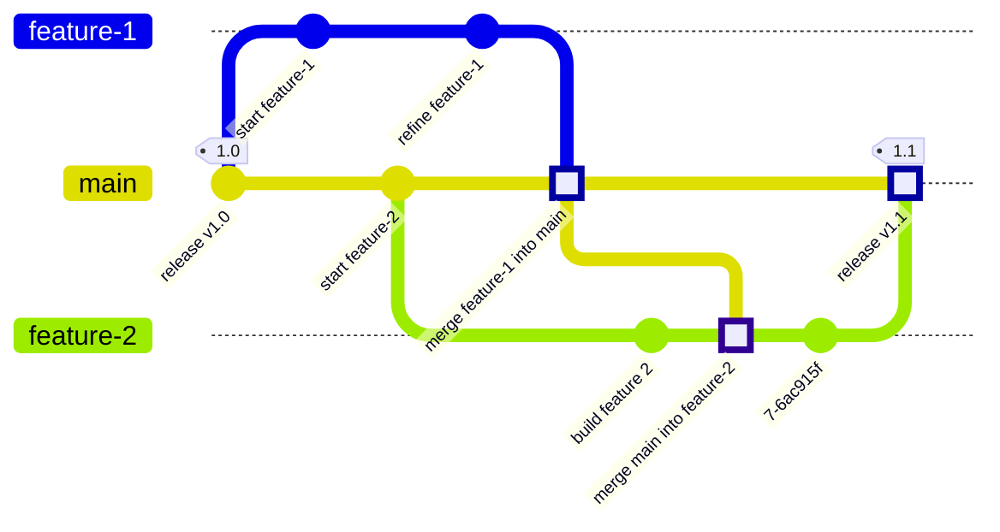
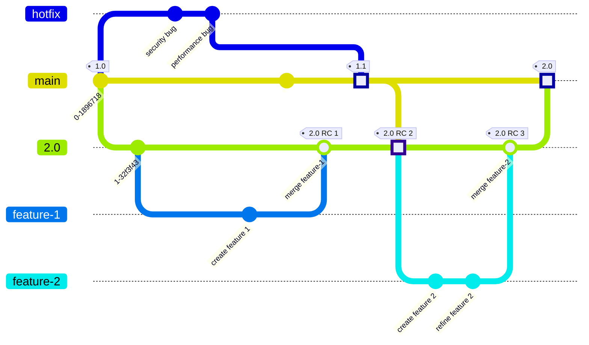
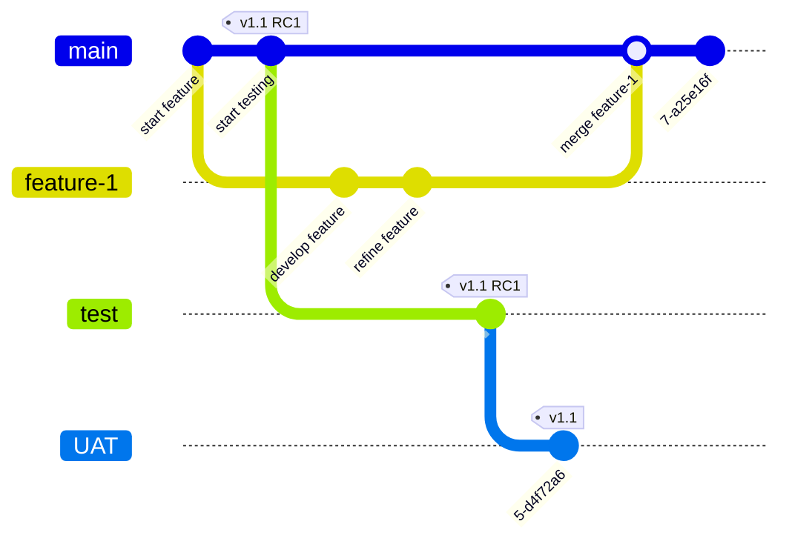

La façon dont vous organisez et fusionnez les branches Git s'appelle une stratégie de branches. Pour de nombreuses équipes, l'approche la plus simple est sensée et efficace :

1. Apportez des modifications dans une branche de fonctionnalité.
1. Fusionnez la branche de fonctionnalité directement dans `main`.

Toutefois, si votre équipe a des besoins complexes (comme des exigences en matière de tests et de conformité), vous pouvez envisager une stratégie de branches différente.

Les sections suivantes décrivent certaines des stratégies les plus courantes disponibles. Tout le monde n'a pas de spécialiste Git (ou de contrôle de version) dans ses équipes. Si votre équipe travaille aux limites de ses compétences Git, ces informations peuvent vous aider.

Lorsque vous utilisez GitLab pour remplacer plusieurs outils disparates, les décisions que vous prenez concernant votre stratégie de branches Git ont de l'importance. Avec une planification soigneuse, vous pouvez établir des liens clairs entre :

- Les rapports de bugs initiaux que vous recevez.
- Les commits que vos équipes effectuent pour corriger ces bugs.
- Les processus de backport de ces corrections vers d'autres versions ou clients.
- Les déploiements qui rendent vos corrections disponibles pour vos utilisateurs.

Des choix judicieux vous permettent de tirer le meilleur parti du magasin de données unique dans GitLab.

## Ai-je besoin d'une stratégie de branches Git plus complexe ? {#do-i-need-a-more-complex-git-branching-strategy}

Vous avez peut-être dépassé votre stratégie de branches Git actuelle si :

- Vous utilisez la livraison continue.
- Vous disposez de tests automatisés significatifs.
- Vous devez corriger des bugs critiques pour un client sans affecter les autres clients.
- Vous maintenez plusieurs versions historiques de votre produit.
- Votre produit n'a pas de branche de production unique, car il prend en charge plusieurs systèmes d'exploitation ou plateformes.
- Votre produit a des exigences de déploiement ou de certification différentes pour chaque version.

N'implémentez pas une stratégie plus complexe que ce dont votre produit a besoin.

### Quand diviser un projet en plusieurs dépôts {#when-to-split-a-project-into-multiple-repositories}

Devez-vous maintenir un seul dépôt Git avec une structure de branches complexe, ou diviser le projet entre plusieurs dépôts ? Il n'y a pas de réponse unique et universelle. Cela dépend du personnel et de l'expertise dont vous disposez pour assurer le support.

GitLab fournit une automatisation qui suppose que votre dépôt est destiné à un seul produit, même si ce produit peut contenir plusieurs versions. Pour déterminer si vous devez avoir plusieurs dépôts ou un seul dépôt complexe, posez-vous ces questions :

- S'agit-il du même produit ?
- Tous les éléments utilisent-ils le même processus de build ?
- Le code sous-jacent est-il similaire ou identique ?

Quelle que soit votre décision (un seul dépôt complexe ou un ensemble de dépôts plus petits), vous devez prévoir de consacrer du temps d'ingénierie à la maintenance. Identifiez le type de travail d'ingénierie que vous êtes prêt à effectuer :

- Si vous maintenez le code de plusieurs produits dans un seul dépôt, prévoyez des travaux de personnalisation ultérieurs pour utiliser toutes les fonctionnalités de GitLab.
- La fusion de travaux entre plusieurs dépôts est plus complexe que la fusion entre des branches d'un même dépôt. Prévoyez du temps d'ingénierie pour créer des processus de release personnalisés et gérer le flux de code entre les dépôts.

> [!note]
> Si votre organisation utilise un large monorepo ou un mégarepo, l'équipe [Professional Services](https://about.gitlab.com/services/) de GitLab peut vous aider à construire une solution de branches personnalisée adaptée à vos besoins.

## Principaux types de stratégies de branches {#major-types-of-branching-strategies}

Les stratégies de branches et de gestion du code dépendent des besoins de votre produit. Aucune stratégie préexistante ne peut toutes les couvrir, mais voici quelques grandes catégories :

- [Services web](#web-services)
- [Branches de release à longue durée de vie](#long-lived-release-branches)
- [Une branche par environnement](#branch-per-environment)

### Services web {#web-services}

Cette stratégie suit les pratiques Git standard. La branche `main` est votre branche de production, ce qui convient parfaitement à un service web unique : il existe une seule version de production canonique, sans prise en charge des révisions précédentes.

Pour cette configuration, [`git-flow`](https://nvie.com/posts/a-successful-git-branching-model/) fonctionne probablement pour vous. Il est standardisé et vous n'avez rien à maintenir.

Dans cet exemple, `feature-1` se ramifie directement depuis `main`. Une fois terminée, `feature-1` est fusionnée directement dans `main`. Ce commit de fusion est mis en évidence par un carré. Les branches à plus longue durée de vie, comme `feature-2`, peuvent périodiquement intégrer les dernières mises à jour de `main` dans le cadre du développement. Une fois terminée, `feature-2` est fusionnée dans `main`, et la release `1.1` est créée :

### Branches de release à longue durée de vie {#long-lived-release-branches}

Cette stratégie de branches convient si votre produit possède des branches qui doivent rester séparées de `main` pendant une longue période. Voici quelques exemples :

- Plusieurs versions de production du même package logiciel. Par exemple : une version actuelle et des versions legacy. La version actuelle reçoit des mises à jour de fonctionnalités et des hotfixes, tandis que les versions précédentes ne reçoivent que des hotfixes et des releases de sécurité.
- Une version de production actuelle et une version bêta à longue durée de vie. Cette approche peut s'avérer nécessaire lorsqu'une dépendance logicielle majeure (comme un kit de développement logiciel, ou SDK) introduit des changements majeurs. La version de production actuelle reçoit des mises à jour de fonctionnalités et des hotfixes. La version bêta reçoit ces mises à jour de fonctionnalités et ces hotfixes, tandis que votre équipe intègre également la prise en charge des prochaines modifications du SDK.

Si vous avez l'intention de verrouiller une branche à longue durée de vie, il est essentiel de définir votre processus de hotfix et de le faire respecter. Si ce processus n'est pas défini et appliqué, chaque modification devient un hotfix.

Dans cet exemple, la branche `2.0` est créée à partir du commit sur `main` pour la release `1.0`. Les fonctionnalités se ramifient depuis la branche `2.0` et y sont fusionnées en retour dans `2.0`. Parallèlement, toutes les branches de hotfix sont basées sur la release la plus récente (`1.0`) de `main`, et sont fusionnées en retour dans `main` en tant que release `1.1`. La branche `2.0` intègre ensuite les modifications de la release `1.1` et les incorpore dans le cadre du développement de `2.0`. Après l'ajout d'une autre fonctionnalité (`feature-2`), la branche `2.0` est prête pour la production. Elle est fusionnée dans `main`, et la release `2.0` est créée :

#### Migration depuis des stratégies de branches SVN {#migrate-from-svn-branching-strategies}

Les projets legacy qui migrent de SVN vers Git doivent revoir leur approche de branches. Certaines approches de branches centrées sur SVN dans Git peuvent vous empêcher de tirer le meilleur parti de GitLab. Quelques workflows à reconsidérer :

- Vous créez une branche à longue durée de vie (comme `1.0`) depuis `main`, puis vous verrouillez la branche `1.0` pour bloquer toute modification qui n'est pas un hotfix pré-approuvé.
  - Git gère les conflits de merge mieux que SVN.
  - Évitez de créer des branches à longue durée de vie, sauf si vous avez des obligations contractuelles de les utiliser. Bien que Git gère bien les conflits, les branches à longue durée de vie vous obligent à passer du temps à fusionner des corrections dans plusieurs branches.
- Vous utilisez des branches parce que votre produit ne prend pas en charge les feature flags.

### Branche par environnement {#branch-per-environment}

Cette stratégie de branches est courante pour les organisations disposant de plusieurs services interdépendants, créés par différentes équipes. Elle est souvent utilisée avec les processus de développement en cascade (waterfall) ou en V.

Dans cet exemple, le commit marqué `v1.1 RC1` est identifié comme un release candidate pour la version `1.1`. Les fonctionnalités continuent de se ramifier depuis `main` et d'y être fusionnées en retour, tandis que le commit du release candidate est testé dans les environnements `test` et `UAT`. Ce processus est répété pour chaque commit envisagé pour une release :

## Sujets connexes {#related-topics}

- [Branches protégées](../protected.md)
- [Approbations des merge requests](../../../merge_requests/approvals/_index.md)
- [Test des résultats fusionnés](../../../../../ci/pipelines/merged_results_pipelines.md)
