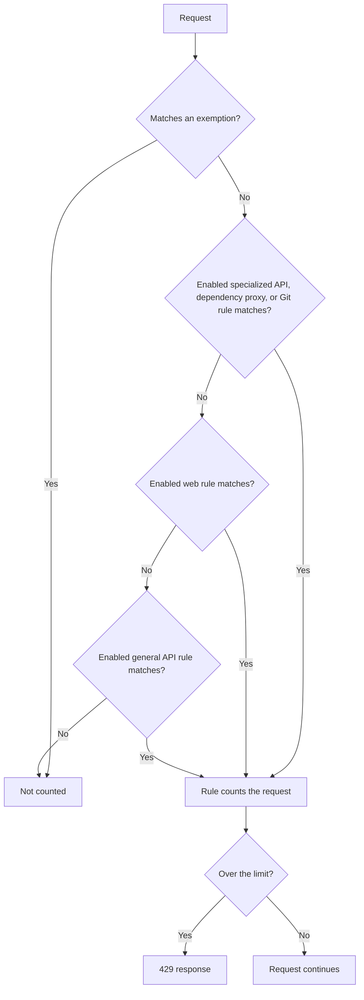
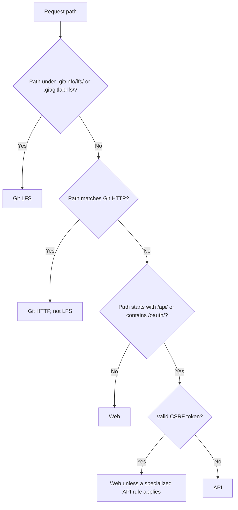



- Tier: Free, Premium, Ultimate
- Offering: GitLab Self-Managed, GitLab Dedicated





- LabKit request rate limiting [enabled by default](https://gitlab.com/gitlab-org/gitlab/-/merge_requests/250401) in GitLab 19.3.



Request rate limits apply before a request reaches a controller or API endpoint.
When several general request limits match a request, only one of them counts it.
GitLab checks the general limits in a fixed order, and the first enabled limit that matches counts the request.
If you disable that limit, the next matching limit counts the request, or no limit does.

The protected paths, Model Context Protocol (MCP) server, and incident management limits count
requests separately, in addition to the general limit.
[Application rate limits](../administration/settings/user_and_ip_rate_limits.md#multiple-rate-limiting-systems)
also apply separately.

GitLab.com has [additional rate limits](../user/gitlab_com/rate_limits.md).

## How GitLab selects a rate limit

With the LabKit rate limiter, which is the default, GitLab checks each request in this order:

1. GitLab skips requests that match an exemption.
1. The general limiter checks its rules in this order: specialized APIs, the dependency proxy,
   Git, web, and the general API.
   The first enabled rule that matches counts the request.
   Later rules in the general limiter do not count the request.
1. The protected paths, MCP, and incident management limiters each check the request on their own.
1. If the request is over any enforced limit, GitLab returns a `429` response.
   The response body is `Retry later` by default.
   To change the response body, see [use a custom rate limit response](../administration/settings/user_and_ip_rate_limits.md#use-a-custom-rate-limit-response).

The diagram shows how the general limiter selects a rule:



### Exemptions

GitLab checks exemptions before any rate limit.
Some exemptions apply to every limiter, and others to specific limiters only:

| Exemption | Applies to | Effect |
| --------- | ---------- | ------ |
| [Bypass header](../administration/settings/user_and_ip_rate_limits.md#use-an-http-header-to-bypass-rate-limiting) | Every limiter | Skips requests whose header named by `GITLAB_THROTTLE_BYPASS_HEADER` has the value `1`. |
| [User allowlist](../administration/settings/user_and_ip_rate_limits.md#allow-specific-users-to-bypass-authenticated-request-rate-limiting) | Every limiter | Skips users listed in `GITLAB_THROTTLE_USER_ALLOWLIST`. Does not skip deploy tokens. |
| Internal API, health checks, and container registry events | General, protected-path, and per-project Git limiters | Skips unauthenticated requests under `/api/v<version>/internal/`, `/-/health`, `/-/liveness`, `/-/readiness`, `/-/metrics`, and `/api/v<version>/container_registry_event/`. |
| Virtual registries and verified Geo requests | General, protected-path, and per-project Git limiters, in GitLab Enterprise Edition | Skips unauthenticated virtual registry requests and verified Geo requests with no user or deploy token. |
| Runner jobs API | General limiter | Skips requests under `/api/v<version>/jobs/` that authenticate with a CI/CD job token. |

To configure per-project Git limits, see [override rate limits for a project](git.md#override-rate-limits-for-a-project).

## Request types

GitLab uses the request path, the authentication, and the cross-site request forgery (CSRF) token
to select a rule.
The path excludes any relative URL prefix for the instance.

| Type | Paths | Examples | Counted by |
| ---- | ----- | -------- | ---------- |
| Git Large File Storage (LFS) | Paths under `.git/info/lfs/` or `.git/gitlab-lfs/`, such as the batch API, locks, and object transfers under `gitlab-lfs/objects/`. | `/<namespace>/<project>.git/info/lfs/objects/batch`, `/<namespace>/<project>.git/info/lfs/locks`, `/<namespace>/<project>.git/gitlab-lfs/objects/<oid>` | Authenticated: Git LFS, or authenticated web if the Git LFS limit is disabled. Unauthenticated: unauthenticated Git HTTP. |
| Git HTTP | Repository paths that Git clients use over HTTP. See the list after this table. | `/<namespace>/<project>.git/info/refs`, `/<namespace>/<project>/info/refs` | Authenticated Git HTTP or unauthenticated Git HTTP. |
| API | Paths that start with `/api/` or contain `/oauth/`. | `/api/v4/projects`, `/oauth/token` | A specialized API limit, or the general API limit. |
| Web | All other paths, except health check paths. | `/<namespace>/<project>` | Web limit. |

A path is a Git HTTP path when it:

- Ends in `.git`.
- Has `/info/refs`, `/git-upload-pack`, `/git-receive-pack`, `/ssh-upload-pack`, or
  `/ssh-receive-pack` after `.git`.
- Ends in `/info/refs` without `.git`.
- Is under `.git/info/lfs/` or `.git/gitlab-lfs/objects/`.
  These paths are also Git LFS paths, and the authenticated Git HTTP limit excludes them.

Each request also has one authentication type:

| Authentication | Definition | Counted for each |
| -------------- | ---------- | ---------------- |
| Authenticated | GitLab resolves a user or deploy token for the request. | User or deploy token |
| Unauthenticated | No user, deploy token, or runner authenticates the request. | IP address |
| Runner | GitLab resolves a runner instead of a user or deploy token, for example for `/api/v4/jobs/request`. | None. No general limit counts the request. |

### Frontend API requests

The GitLab frontend sends API requests with the CSRF token of the browser session in the
`X-CSRF-Token` header.
Browser sessions of visitors who are not signed in also have a CSRF token.
GitLab treats an API request with a valid CSRF token as web traffic, whether or not the request
is authenticated:

- A specialized API limit counts the request if one matches.
- Otherwise, the web limit counts the request.
- The general API limit never counts the request, even when the web limit is disabled.

The diagram shows how GitLab classifies common paths:



## Order of general rate limits

The general limiter, `rack_request`, checks these rules from top to bottom.
Each rule applies only when you enable its setting.

Authenticated rules count requests for each user or deploy token, even when the setting label mentions only users.

The last column shows which limit counts the request when you disable the rule.
That limit must also be enabled.
For a specialized API request with a valid CSRF token, the next limit is web instead of API.

| Order | Rate limit | Applies to | Counted for each | If disabled, counted by |
| ----- | ---------- | ---------- | ---------------- | ----------------------- |
| 1 | : , [`throttle_unauthenticated_packages_api`](api/package-registry.md#enable-unauthenticated-request-rate-limit-for-packages-api) | Unauthenticated requests to covered package API endpoints, such as `/api/v4/projects/<id>/packages/npm/`. Not all package API endpoints use this limit. | IP address | Unauthenticated API. |
| 2 | : , [`throttle_authenticated_packages_api`](api/package-registry.md#enable-authenticated-api-request-rate-limit-for-packages-api) | Authenticated requests to covered package API endpoints. | User or deploy token | Authenticated API. |
| 3 | , [`throttle_authenticated_dependency_proxy`](../administration/settings/user_and_ip_rate_limits.md#enable-authenticated-dependency-proxy-request-rate-limit) | Authenticated container manifest and blob requests under `/v2/<group>/dependency_proxy/containers/`. | User or deploy token | Authenticated web. |
| 4 | : , [`throttle_unauthenticated_files_api`](api/repository-files.md#define-files-api-rate-limits) | Unauthenticated requests under `/api/v<version>/projects/<id>/repository/files/` with a file path. | IP address | Unauthenticated API. |
| 5 | : , [`throttle_authenticated_files_api`](api/repository-files.md#define-files-api-rate-limits) | Authenticated requests under `/api/v<version>/projects/<id>/repository/files/` with a file path. | User or deploy token | Authenticated API. |
| 6 | : , [`throttle_unauthenticated_deprecated_api`](api/deprecated.md#define-deprecated-api-rate-limits) | Unauthenticated requests to `/api/v<version>/groups/<id>` with `with_projects` absent, blank, or true. | IP address | Unauthenticated API. |
| 7 | : , [`throttle_authenticated_deprecated_api`](api/deprecated.md#define-deprecated-api-rate-limits) | Authenticated requests to `/api/v<version>/groups/<id>` with `with_projects` absent, blank, or true. | User or deploy token | Authenticated API. |
| 8 | , [`throttle_authenticated_git_lfs`](git.md#configure-git-lfs-rate-limits) | Authenticated Git LFS requests. | User or deploy token | Authenticated web. |
| 9 | , [`throttle_authenticated_git_http`](git.md#configure-authenticated-git-http-rate-limits) | Authenticated Git HTTP requests, except LFS. | User or deploy token | None, not authenticated web. |
| 10 | , [`throttle_unauthenticated_git_http`](git.md#configure-unauthenticated-git-http-rate-limits) | Unauthenticated Git HTTP requests, including LFS batch, locks, and object transfers under `gitlab-lfs/objects/`. | IP address | None, not unauthenticated web. |
| 11 | , [`throttle_unauthenticated_web`](../administration/settings/user_and_ip_rate_limits.md#enable-unauthenticated-web-request-rate-limit) | Unauthenticated web and frontend API requests. Excludes Git HTTP paths, even when the Git HTTP limits are disabled. | IP address | None. |
| 12 | , [`throttle_authenticated_web`](../administration/settings/user_and_ip_rate_limits.md#enable-authenticated-web-request-rate-limit) | Authenticated web and frontend API requests. Excludes Git HTTP paths except LFS, even when the Git HTTP limits are disabled. | User or deploy token | None. |
| 13 | , [`throttle_unauthenticated_api`](../administration/settings/user_and_ip_rate_limits.md#enable-unauthenticated-api-request-rate-limit) | Unauthenticated API requests with no valid CSRF token that no earlier rule counted. | IP address | None. |
| 14 | , [`throttle_authenticated_api`](../administration/settings/user_and_ip_rate_limits.md#enable-authenticated-api-request-rate-limit) | Authenticated API requests with no valid CSRF token that no earlier rule counted. | User or deploy token | None. |

## Limits that count separately

These limiters count a request in addition to the general limiter.
Disabling one of them does not change which general limit counts the request.
Each [protected path](../administration/settings/protected_paths.md) rule has its own counter,
even though the rules share one configuration.

| Limiter | Rate limit | Applies to | Counted for each |
| ------- | ---------- | ---------- | ---------------- |
| `rack_request_protected_paths` |  | `POST` requests to a prefix in , or `GET` requests to a prefix in . | IP address for unauthenticated requests, or user or deploy token for authenticated requests. |
| `rack_request_mcp` | , [`throttle_authenticated_mcp`](../administration/settings/user_and_ip_rate_limits.md#enable-authenticated-mcp-server-request-rate-limit) | Authenticated requests to `/api/v<version>/mcp` or paths below that endpoint, regardless of the HTTP method or body. | User or deploy token |
| `rack_request_incident_management` | , [`throttle_incident_management_notification_web`](../administration/settings/incident_management_rate_limits.md) | Paths that contain `alerts/notify`, except API and health check paths, in GitLab Enterprise Edition. | Request path |

## Configuration examples

These examples assume the LabKit rate limiter and no exemption.
API requests in the examples have no valid CSRF token.
All limits not listed in the second column are disabled.

| Request | Limits enabled | Counted by |
| ------- | -------------- | ---------- |
| Authenticated Git LFS | Git LFS and authenticated web | Git LFS only. |
| Authenticated Git LFS | Authenticated web only | Authenticated web. |
| Authenticated Git LFS | None | None. |
| Authenticated Git HTTP, not LFS | Authenticated Git HTTP and authenticated web | Authenticated Git HTTP only. |
| Authenticated Git HTTP, not LFS | Authenticated web only | None. |
| Unauthenticated Git HTTP, including LFS batch, locks, and object transfers | Unauthenticated Git HTTP and unauthenticated web | Unauthenticated Git HTTP only, for each IP address. |
| Unauthenticated Git HTTP, including `/<namespace>/<project>/info/refs` | Unauthenticated web only | None. |
| First unauthenticated attempt of a Git HTTP operation | Unauthenticated Git HTTP | Unauthenticated Git HTTP, for each IP address. |
| Covered packages API, files API, or deprecated API request | Specialized API limit and general API limit with the same authentication | Specialized API limit only. |
| Covered packages API, files API, or deprecated API request | General API limit with the same authentication only | General API limit. |
| Authenticated MCP API request | Authenticated API and MCP | Both limits. |
| `GET` or `POST` request to a protected path | Protected paths and the applicable general limit | Both limits, with separate counters. |

## Dry run mode

In dry run mode, an enabled limit counts requests but does not block them.
The limit still stops the check for the requests it matches, so later rules in the general limiter
do not count them.
As a result, no general limit blocks these requests.
For example, with `throttle_authenticated_git_lfs` in dry run mode, LFS requests do not count against
the authenticated web limit.

For configuration and the required Puma restart, see [try out throttles before enforcement](../administration/settings/user_and_ip_rate_limits.md#try-out-throttling-settings-before-enforcing-them).

## Rack::Attack fallback

The first-match behavior applies only when all six LabKit feature flags are enabled, which is the default:

- `rate_limiter_use_labkit_rack_cohort_1` and `rate_limiter_use_labkit_rack_cohort_1_enforce`
- `rate_limiter_use_labkit_rack_cohort_2` and `rate_limiter_use_labkit_rack_cohort_2_enforce`
- `rate_limiter_use_labkit_rack_cohort_3` and `rate_limiter_use_labkit_rack_cohort_3_enforce`

If any of these flags is disabled, `Rack::Attack` also checks the requests that LabKit passes through.
`Rack::Attack` does not use rule order, so one request can count against several general limits.
For example, a frontend API request to a specialized API path can count twice.
When both limits are enabled, the request counts against the specialized limit and the web limit.

## Troubleshooting

### Identify the rate limit that counted or blocked a request

To identify the rule and the counter:

1. Check the `RateLimit-Name` response header, for example `throttle_authenticated_git_http`.
   LabKit and `Rack::Attack` both set this header on blocked requests.
   For the quota and retry headers, see [response headers](../administration/settings/user_and_ip_rate_limits.md#response-headers).
1. In GitLab 19.5 and later, check `rate_limit_state` in `production_json.log` or `api_json.log`.
   This field names the LabKit rule that counted the request, even when the request was below the limit.
   For example:

   ```json
   ["rack_request:authenticated_git_lfs:allow","rack_request:authenticated_git_lfs_claim:skip"]
   ```

   Blocked requests do not reach the application, so these logs have no entry for them.
   For the field definition, see [request log fields](../administration/logs/_index.md#production_jsonlog).
1. In GitLab 19.5 and later, for requests that LabKit blocked, check `auth_json.log` for
   `Rate_Limit_Block` messages.
   GitLab does not log every blocked request.
   For examples, see [`Rate_Limit_Block` messages](../administration/logs/_index.md#rate_limit_block-messages).
1. If the `Rack::Attack` fallback applies, check `auth_json.log` for `Rack_Attack` messages with
   `status: 429`.
   The `matched` field names the throttle that blocked the request.

To monitor LabKit rule results across requests, use the
`gitlab_labkit_rate_limiter_rule_evaluations_total` metric in GitLab 19.4 and later,
or `gitlab_labkit_rate_limiter_calls_total` in GitLab 19.3.

### Git LFS requests blocked by an unexpected rate limit

An LFS request can receive `RateLimit-Name: throttle_authenticated_web` when the Git LFS limit is
disabled.
The request then shares the authenticated web limit with all other web requests from the same user or deploy token.
To give LFS its own limit, enable the Git LFS rate limit.

If the response names `throttle_authenticated_git_http`, check your GitLab version.
In GitLab 18.1 through 18.7.1 and 18.8.0 through 18.8.3, the authenticated Git HTTP limit also counts
Git LFS requests.
An upgrade from GitLab 18.6 or earlier to 18.7 or later enables the Git HTTP limit if:

- The authenticated web limit is enabled.
- The Git HTTP limit is disabled.

The Git HTTP limit then uses the web limit settings.

To resolve this problem, upgrade to GitLab 18.7.2, 18.8.4, or later.
These versions [exclude LFS requests from the Git HTTP limit](https://gitlab.com/gitlab-org/gitlab/-/merge_requests/218748).
As a workaround, raise the request limit of the [authenticated Git HTTP rate limit](git.md#configure-authenticated-git-http-rate-limits):

- In GitLab 18.7.0 and 18.7.1, if the Git HTTP limit is disabled, enable it first.
  While the authenticated web limit is enabled, a disabled Git HTTP limit still applies with
  the web limit settings.
- In GitLab 18.8.0 through 18.8.3, you can disable the Git HTTP limit instead.
  Git HTTP requests then have no request rate limit.

### Git operations blocked by the unauthenticated Git HTTP rate limit

A Git HTTP client can send a request without credentials before it sends a request with credentials.
The first request counts against the unauthenticated Git HTTP limit for that IP address.
CI/CD jobs behind the same network address translation (NAT) gateway share that counter.
To resolve this problem, raise the unauthenticated Git HTTP rate limit.

### Git HTTP requests not rate limited

The authenticated web limit excludes Git HTTP paths except LFS, even when the Git HTTP limit is disabled.
If only the authenticated web limit is enabled, those Git HTTP requests have no request rate limit.
To apply a limit, enable the authenticated Git HTTP rate limit.
